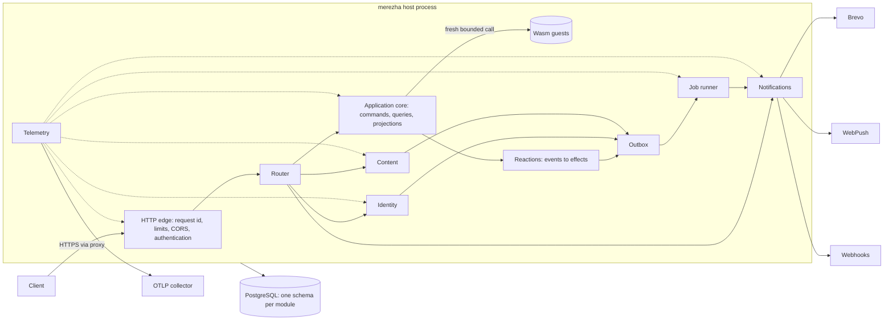

# Backend framework architecture

Status: accepted 2026-10-23, amended 2026-10-24 by
[cross-block decisions](../design/cross-block-decisions.md). This document turns Merezha from an application
runtime into the default backend engine for new projects. It records the
product decisions, the module architecture every block follows, and the
delivery order. Block designs live in `docs/design/` and must stay consistent
with this document; a conflict is resolved here first.

## Product decisions

| Topic | Decision |
| --- | --- |
| Business logic | Rust guests compiled to Wasm on the existing domain SDK. TypeScript guests are a later research track; nothing here may assume them. |
| Project shape | A project repository holds `merezha.toml`, its runtime and application manifests and its guest crates. The prebuilt `merezha` host runs it. Blocks are switched on in configuration. `merezha new` scaffolds a project. |
| Database | PostgreSQL only for production, version 14 or later (CI runs 16). One database per application. The existing SQLite store remains for tests and the local examples. |
| Identity | Email and password with server-side sessions, email verification, password reset and magic links; OAuth 2.0 / OpenID Connect social login; organizations (tenants) with memberships, invitations and scoped roles; application-level roles for apps without organizations; RBAC; API keys and service accounts scoped to the application or an organization; WebAuthn passkeys. Registration is open by default. |
| Content | Headless CMS API: content types declared in configuration, entries with drafts, publishing, version history and media assets. Every content type declares its delivery access; there is no default. No admin UI. |
| Notifications | Email through the Brevo transactional API, SMS through Brevo, Web Push (VAPID), an in-app inbox with realtime delivery over Server-Sent Events, and signed outgoing webhooks. FCM/APNs are deferred. |
| Telemetry | OpenTelemetry over OTLP for traces, metrics and logs, plus liveness and readiness endpoints. |
| Deployment | One application per host process now; every design keeps the path to a multi-application platform (the user's PaaS) open. |
| Local stack | A Contremaitre environment supplies PostgreSQL and companions for development. Tests use any PostgreSQL reachable through `MEREZHA_TEST_DATABASE_URL`; CI uses a PostgreSQL service container. |

## Shape of a running application

Everything runs in one process, a modular monolith. Each block is a bounded
context with its own crate, PostgreSQL schema, migrations, HTTP routes and
published events. Blocks never read another block's tables. They talk through
ports defined in `merezha-platform` and through integration events in the
outbox.

## Kernel contracts

Two crates form the kernel. Every block depends on them, so they land first.

### `merezha-postgres`

- One `deadpool-postgres` pool over `tokio-postgres`, configured from
  `database.url` (a secret) with bounded size, connection, acquisition and
  statement timeouts. TLS is optional, with `rustls`.
- A migration runner. A module declares an ordered list of `Migration
  { version, name, sql }`. The runner takes a PostgreSQL advisory lock, records
  `(module, version, name, checksum, applied_at)` in `merezha.migrations`,
  refuses a changed checksum or an unknown applied version, and applies
  pending migrations in one transaction each. Migrations are forward-only and
  additive by default (expand, migrate, contract). The host applies them at
  startup only when `database.migrate = true`; otherwise it verifies that
  every applied version matches and refuses readiness if anything is pending.
- Transaction helpers that set `statement_timeout` from the caller's deadline.
- A test harness: `TestDatabase::create()` connects to
  `MEREZHA_TEST_DATABASE_URL`, creates a uniquely named database, and drops it
  on drop. Tests skip with an explicit message when the variable is unset. CI
  sets it.

### `merezha-platform`

- `ProjectConfig`, the typed model of `merezha.toml`. Precedence, lowest to
  highest: code defaults, the file, `MEREZHA_<SECTION>__<KEY>` environment
  variables, then CLI flags. Secrets are never literal in the file: a secret
  field accepts `{ env = "NAME" }` or `{ file = "/path" }`. Unknown keys and
  invalid combinations fail startup, with every error reported at once.
- The `Module` trait. Each block implements it:
  - `name()`, its configuration section and its `migrations()`
  - `routes()`, an axum router mounted under `/v1/<module>/`
  - `start(ctx)` and `shutdown()` for background tasks, with bounded drain
  - `ready()` for readiness contributions
  - the integration events it publishes and consumes
- `AppContext`, shared by modules: the pool, a `Clock`, a CSPRNG, the outbound
  HTTP client (reqwest with rustls, a per-call deadline, no automatic retries),
  the outbox publisher and the cross-module ports below.
- The HTTP edge: listen address (loopback by default; a public address needs
  `http.public = true`), trusted proxy CIDRs for `X-Forwarded-*`, request
  body limits, request id and W3C `traceparent` propagation, CORS, and one
  error shape `{ "error": { "code", "classification", "details"? } }` with
  stable, unprefixed codes. Modules register their codes and HTTP statuses in
  one registry. `details` carries field-level validation errors only. No error
  contains secrets or guest text.
- `/health/live` (process responsive), `/health/startup` (answered by an early
  listener before modules start) and `/health/ready` (configuration valid,
  migrations current, pool healthy, modules ready). Readiness never reports
  details publicly. A module may hold readiness for a bounded warm-up;
  projection lag never counts after it, and job backlog counts only when
  configured.
- Structured JSON logs on stderr through `tracing` with stable event names
  from the telemetry catalog. The telemetry block adds the OTLP exporters to
  this subscriber and the admin status route `/v1/admin/status`.

### Cross-module ports

| Port | Defined in | Implemented by | Used by |
| --- | --- | --- | --- |
| `Authenticator`: resolves a request (session cookie, `Authorization: Bearer` session or API key) to a `Principal` | platform | identity | edge |
| `Principal { subject, kind (user/api_key/system), tenant, user, grants, session facts }`; system subjects are `sys_<name>` | platform | identity | everyone |
| `Authorizer`: checks `(principal, permission, scope)` where scope is the application, a tenant, or a resource | platform (extends the application `Authorizer`) | identity (RBAC) | application, content, notifications, telemetry |
| `Directory`: batch contact lookup and tenant or application membership | platform | identity | notifications |
| `Notifier`: requests a notification inside the caller's transaction, to users, a tenant's or the application's roles, or an address, on named channels with a topic, data and secret data; emits webhooks | platform | notifications | identity (verification, reset, invitations, magic links), reactions |
| `Outbox`: appends integration events and job records inside the caller's transaction | platform + postgres | jobs | all blocks |
| `BlobStore`: streaming put and get, head, delete, and signed URLs where supported | platform | content (local filesystem and S3-compatible drivers) | content |

When a block is disabled, its port has a defined fallback. Without identity,
the application keeps the explicit `AllowAll` policy, and only on loopback.
Without notifications, the `Notifier` is a capture sink that logs a redacted
record. A disabled port never silently drops a security-relevant effect.

## Application core on PostgreSQL

- A PostgreSQL implementation of the application storage, schema `merezha_app`:
  atomic expected-version append with contiguous global positions, keyed
  receipts committed with the events, and projection state and checkpoints
  with row-revision compare-and-swap. It keeps the SQLite contracts and their
  tests. Multiple host instances may share a database: append conflicts are
  serialized by the database, not by an owner lock. Projection catch-up runs
  under an advisory lock per projection.
- Projections catch up automatically after each accepted command, in the
  background, and on a configurable interval. The explicit catch-up and
  rebuild endpoints remain as administrative operations.

## Guests and the blocks

Guests stay import-free and deterministic. They never receive secrets,
network access or database handles.

- **Protocol version 2** adds a host-established `principal` (subject, kind,
  tenant, roles) to the guest metadata. Version 1 guests keep working: the host
  sends version 2 only to guests whose manifest declares it. Guests use the
  principal for ownership rules; they do not authenticate.
- **Route permissions:** each command and query route in `application.toml` may
  declare `permission = "tasks.create"` with an application or tenant scope, or
  `access = "public" | "authenticated"`. The host enforces it before any guest
  call. The permission catalog
  is the union of block permissions and application permissions.
- **Reactions:** a guest may implement the new `react` operation. For a
  committed event it returns effect requests: notify, call a webhook, or issue
  a command. The host hands them to the notifier and the outbox in the same
  transaction as the reaction checkpoint, keyed by
  `(reactor, event_id, index)`, and the job runner
  delivers them at least once. This is how application events become emails
  or webhooks without giving guests I/O.

## Jobs and the outbox

`merezha_jobs` holds outbox records and jobs. Workers lease them with
`FOR UPDATE SKIP LOCKED`, a lease deadline, bounded concurrency per queue,
exponential backoff with jitter, and a maximum attempt count. Exhausted jobs go
to a dead-letter state you can list and replay. Every job carries an
idempotency key, and handlers must tolerate duplicate delivery. Delayed and
recurring jobs (cron expressions) are included because notifications and
cleanup need them.

## Security baseline

- Passwords: Argon2id with parameters in configuration, a minimum length (12
  by default, never below 8) plus a breached-password check with no
  composition rules, and constant-time comparison. Session and API
  key secrets: 256-bit random values. Only their SHA-256 digests are stored.
- Cookies: `__Host-` prefix, `Secure`, `HttpOnly` and `SameSite=Lax`. Only a
  loopback development listener drops `__Host-` and `Secure`.
  State-changing cookie-authenticated requests need an `Origin` check plus a
  CSRF token.
- Rate limits on login, registration, reset, magic links and verification,
  per IP and per account, are kept in PostgreSQL so they survive restarts.
- Audit events for authentication, membership, role and API key changes are
  kept apart from diagnostic logs.
- Logs, traces and metrics never contain passwords, tokens, cookies, full
  email bodies or unredacted personal data. Telemetry attributes are
  allowlisted.

## Delivery order

| Stage | Work | Depends on |
| --- | --- | --- |
| K | `merezha-postgres`, `merezha-platform`, `merezha run --config merezha.toml`, Contremaitre environment, CI PostgreSQL | main |
| K2 | Port contracts aligned with the cross-block decisions: outbox, notifier, directory, scopes, error registry, `[jobs]` and durations, principal, blob store | K |
| 1 | Application storage on PostgreSQL; jobs and outbox; telemetry (OTLP); identity core (accounts, password, sessions, verification, reset, magic links) | K2 |
| 2 | Organizations, RBAC and API keys; OAuth/OIDC and passkeys; notifications (email, SMS, Web Push, inbox with SSE, webhooks); content (types, entries, drafts, versions, media) | 1 |
| 3 | Guest protocol version 2, route permissions and reactions; `merezha new`; an example application using every block; operations guide | 2 |

Each stage item is a separate pull request. It ships with tests against real
PostgreSQL, documentation exercised as written, an independent review and
green CI before merge. The slice-level order is in the
[cross-block decisions](../design/cross-block-decisions.md#delivery-order).

## Out of scope for this program

An admin UI, TypeScript guests, multi-application scheduling inside one
process, FCM/APNs, full-text search beyond PostgreSQL's built-in features,
and billing. Each needs its own decision.
