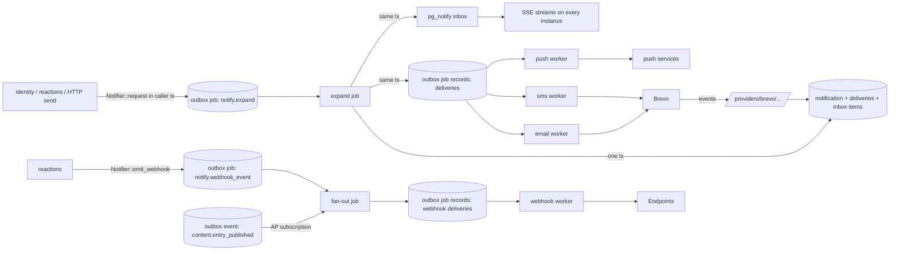

# Notifications block design

Status: proposed 2026-10-23. Conforms to
[`docs/architecture/framework.md`](../architecture/framework.md) (accepted).
If this document and the framework disagree, the framework wins.
[Cross-block decisions](cross-block-decisions.md) (R1 to R15) wins over both;
the answers that shape this block are listed in [Decisions](#12-decisions).

The block ships as the crate `merezha-notifications`. It mounts its routes under
`/v1/notifications/`, reads `[modules.notifications]` and owns the PostgreSQL
schema `merezha_notify`. It owns and implements the `Notifier` port (R2). It
sends email and SMS through Brevo, Web Push with VAPID, in-app inbox items with
an SSE stream, and signed outgoing webhooks. FCM and APNs are out of scope.

Parity source: `@structure-ai/mailer` (driver port, transient/permanent
classification, capture driver, Brevo driver over `POST /v3/smtp/email`,
templates with canonical preview data, no subject or body in logs) and
`@structure-ai/jobs` (leased at-least-once jobs, fenced completion, dead
letters, cron with the skip missed-run policy). Structure has no inbox, push,
SMS or outgoing webhooks, so those parts have no parity target. Structure ADR-0022
(coalesced commit wake-ups, subscribe before catch-up) is the model for the
SSE fan-out below, extended across processes with PostgreSQL `LISTEN/NOTIFY`.

## 1. Language

| Term | Meaning |
| --- | --- |
| **Notification** | One request to tell one or more recipients about one thing, for example "password reset requested for token T". It is identified by `(source, dedupe_key)` and stored once, however many times it is requested. |
| **Source** | The module behind a notification or webhook event: `identity`, `application` (reactions), `api` (HTTP send), `notifications` (the block's own alerts), or a module whose events the block subscribes to (`content`). The host binds it, so a caller cannot pick another caller's source. |
| **Tenant** | An identity organization. Tenant-scoped data carries its id; data without one belongs to the application (R5). |
| **Topic** | A named kind of notification declared in configuration, for example `identity.password_reset`. It fixes the category, the allowed and default channels, the template and the priority. Preferences are expressed per topic. |
| **Category** | `security` (cannot be turned off, no unsubscribe link), `transactional` (on by default, can be turned off per channel) or `marketing` (off until the user opts in, one-click unsubscribe required). |
| **Channel** | `email`, `sms`, `push` or `inbox`. Outgoing webhooks are a separate pipeline, not a channel, because they target registered endpoints rather than people. |
| **Recipient** | Who a notification is addressed to: a user, a tenant (expanded to its members, optionally filtered by role), the holders of application-scope roles, or an address (email or E.164 phone number). |
| **Target** | The concrete destination of one delivery: an email address, a phone number, one push subscription, or a user's inbox. |
| **Template** | A named set of per-locale, per-channel files rendered with minijinja from the notification data. |
| **Delivery** | One notification sent to one target on one channel. This is the unit of status, retry and idempotency. |
| **Attempt** | One try at a delivery: one provider HTTP call, or one inbox insert. |
| **Provider event** | A status report from a provider about an accepted delivery (Brevo `delivered`, `hard_bounce` and so on). |
| **Preference** | A user's on/off choice for a `(topic, channel)` pair, or for `(*, channel)`. |
| **Suppression** | A block on an address for a channel (and optionally one topic), caused by an unsubscribe, a hard bounce, a spam complaint or an operator. |
| **Push subscription** | A browser's Push API subscription (`endpoint`, `p256dh`, `auth`), bound to a user and to the VAPID public key it was created with. |
| **Inbox item** | A rendered notification stored for a user, with read and archived state. It is what the in-app inbox lists and what the SSE stream carries. |
| **Webhook event** | An integration event addressed to one tenant's webhook endpoints, or to the application-level endpoints when it has no tenant, for example `content.entry_published`. |
| **Webhook endpoint** | An HTTPS URL registered by a tenant or at application level (NT6), with an event-type filter and a signing secret. |
| **Webhook delivery** | One webhook event sent to one endpoint. It is retried on its own schedule and signed again on every attempt. |

## 2. Model, invariants, schema, outbox

### 2.1 Flow



### 2.2 Invariants

1. A notification exists at most once per `(source, dedupe_key)`. Its id is
   `UUIDv5(NS_NOTIFY, source || "\n" || dedupe_key)`, so callers know it
   before expansion runs.
2. A delivery exists at most once per `(notification_id, channel,
   target_key)`. Its id is `UUIDv5(NS_DELIVERY, notification_id || "\n" ||
   channel || "\n" || target_key)`. Rerunning an expansion cannot create a
   second delivery.
3. Expansion is one transaction. The notification row, every delivery row,
   every inbox item, every delivery job record (`OutboxTarget::Job`, R1) and
   the `pg_notify` calls either all commit or none do.
4. Before each provider call, an attempt row with outcome `started` is
   committed. When a worker finds a `started` attempt, the previous outcome is
   unknown, and it follows the channel's ambiguity rule (section 5) instead of
   assuming failure.
5. Once a delivery is settled (`accepted` or any terminal status), no job may
   send it again. The only way to send it again is an explicit
   redelivery, which increments `generation` and is allowed only from
   `failed`, `unknown` or `expired`.
6. `security` topics ignore preferences and quiet hours (N9). They do not ignore
   `invalid` suppressions or the configured channel set.
7. A `marketing` delivery to a user is created only when that user has an
   explicit `enabled = true` preference for the topic and channel. A marketing
   delivery to an address is never created if the address is suppressed for
   that topic, or globally.
8. Template data is never written to logs, traces or metrics. It is deleted
   (`data = NULL`) `retention.data_after_settled` after every delivery has
   settled. `secret_data` (R2) is never written to a `merezha_notify` table
   other than the development-only `captures` (section 8): it lives in outbox
   and job payloads flagged `contains_secret`, which the relay and the jobs
   runtime null (R3).
9. A webhook delivery exists at most once per `(webhook_event_id,
   endpoint_id)`. Its body bytes are frozen when it is created, and every
   attempt signs exactly those bytes.
10. An outgoing HTTP request to a URL supplied by a tenant or a browser (webhook
    endpoint, push endpoint) goes only to IP addresses that passed the egress
    guard, with redirects and proxies disabled.
11. An inbox item's `change_seq` strictly increases on each change, per user.
    It comes from the user's `inbox_counters` row, locked until commit, so a
    user's changes commit in `change_seq` order (5.4). An SSE client that
    resumes from `Last-Event-ID = n` receives every item whose current
    `change_seq > n`, once, in order.

### 2.3 Delivery state machine

```
queued ──► sending ──► accepted ──► delivered
  │           │  ▲         ├──────► bounced      (hard bounce, invalid)
  │           │  │         ├──────► complained   (spam)
  │           ▼  │         └──────► failed       (blocked, error event)
  │        retrying
  │           │
  │           ├──► failed     (permanent, retries exhausted, data purged, render error)
  │           ├──► unknown    (SMS ambiguity, never resent: NT1)
  │           └──► expired    (expires_at passed before acceptance)
  ├──► skipped    (preference, suppression, no address, no subscription)
  └──► cancelled  (manual)
inbox: created directly as delivered.
```

`accepted` is settled but not terminal: provider events can still move it to
`delivered`, `bounced`, `complained` or `failed`. The other statuses are
terminal, with one exception: a provider event can move `unknown` to
`delivered`, `bounced` or `failed`. A bounce or a spam complaint can also
follow `delivered` (an asynchronous bounce, a complaint after reading), so
`hard_bounce` and `invalid_email` may move `delivered` to `bounced` and
`spam` may move it to `complained` (N3). An event never moves a delivery
that is still `queued`, `sending` or `retrying`; its worker records the
outcome.

### 2.4 Schema `merezha_notify`

Each slice adds its tables in its own migration (section 11). The schema has
no foreign keys into other modules' schemas: `user_id` and `tenant_id` are
opaque identity ids. Identity renders them as prefixed text (`usr_<hex>`,
R7), so migration 2 (N2) stores every `user_id` and `tenant_id` column as
`text` (at most 128 bytes) and adds the recipient's display name to
`deliveries` (`name`, nulled with the data); the listing below keeps
migration 1 as it was applied.

```sql
CREATE SCHEMA IF NOT EXISTS merezha_notify;
SET search_path = merezha_notify;   -- the migration runner sets it per module; shown for brevity

-- Migration 1 (slice N1/N2): core
CREATE TABLE notifications (
  id uuid PRIMARY KEY,
  source text NOT NULL CHECK (source ~ '^[a-z][a-z0-9_]{0,31}$'),
  dedupe_key text NOT NULL CHECK (dedupe_key ~ '^[A-Za-z0-9_.:/-]{1,200}$'),
  topic text NOT NULL, template text NOT NULL, locale text, tenant_id uuid,
  category text NOT NULL CHECK (category IN ('security','transactional','marketing')),
  priority text NOT NULL CHECK (priority IN ('low','normal','high')),
  data jsonb,                                   -- NULL after purge; never secret_data
  data_purged_at timestamptz,
  has_secret boolean NOT NULL DEFAULT false,    -- request carried secret_data: no redelivery
  channels text[] NOT NULL,
  collapse_key text CHECK (length(collapse_key) <= 64),
  not_before timestamptz, expires_at timestamptz,
  correlation_id text, causation_id text,
  status text NOT NULL CHECK (status IN ('expanded','rejected')),
  status_reason text,
  target_count integer NOT NULL,
  requested_at timestamptz NOT NULL, expanded_at timestamptz NOT NULL,
  settled_at timestamptz,                       -- all deliveries settled
  UNIQUE (source, dedupe_key)
);
CREATE INDEX notifications_purge_idx ON notifications (settled_at)
  WHERE data IS NOT NULL AND settled_at IS NOT NULL;

CREATE TABLE deliveries (
  id uuid PRIMARY KEY,
  notification_id uuid NOT NULL REFERENCES notifications(id) ON DELETE CASCADE,
  channel text NOT NULL CHECK (channel IN ('email','sms','push','inbox')),
  target_key text NOT NULL CHECK (length(target_key) <= 400),
  user_id uuid, push_subscription_id uuid,
  address text CHECK (length(address) <= 320),  -- email or E.164
  locale text NOT NULL,
  status text NOT NULL CHECK (status IN ('queued','sending','retrying','accepted','delivered',
    'bounced','complained','failed','skipped','expired','unknown','cancelled')),
  status_reason text CHECK (status_reason ~ '^[a-z0-9_]{1,64}$'),
  provider text CHECK (provider IN ('brevo','webpush','inbox','capture')),
  provider_message_id text CHECK (length(provider_message_id) <= 256),
  attempt_count integer NOT NULL DEFAULT 0,
  generation integer NOT NULL DEFAULT 0,
  run_at timestamptz NOT NULL, created_at timestamptz NOT NULL, updated_at timestamptz NOT NULL,
  accepted_at timestamptz, settled_at timestamptz,
  UNIQUE (notification_id, channel, target_key)
);
CREATE INDEX deliveries_provider_msg_idx ON deliveries (provider, provider_message_id)
  WHERE provider_message_id IS NOT NULL;
CREATE INDEX deliveries_open_idx ON deliveries (status, updated_at)
  WHERE status IN ('queued','sending','retrying');
CREATE INDEX deliveries_notification_idx ON deliveries (notification_id);

CREATE TABLE delivery_attempts (
  delivery_id uuid NOT NULL REFERENCES deliveries(id) ON DELETE CASCADE,
  attempt integer NOT NULL CHECK (attempt >= 1),
  generation integer NOT NULL,
  started_at timestamptz NOT NULL, finished_at timestamptz,
  outcome text NOT NULL CHECK (outcome IN ('started','accepted','duplicate','transient',
    'rate_limited','permanent','ambiguous')),
  http_status smallint,
  error_code text CHECK (error_code ~ '^[a-z0-9_]{1,64}$'),
  retry_after_ms integer,
  PRIMARY KEY (delivery_id, attempt)
);

CREATE TABLE provider_events (
  id bigint GENERATED ALWAYS AS IDENTITY PRIMARY KEY,
  provider text NOT NULL,
  channel text NOT NULL CHECK (channel IN ('email','sms')),
  event text NOT NULL CHECK (event ~ '^[a-z_]{1,32}$'),   -- normalized name
  event_key text NOT NULL,                                 -- dedupe key (5.2)
  delivery_id uuid,                                        -- NULL if uncorrelated
  provider_message_id text,
  reason text CHECK (length(reason) <= 200),
  occurred_at timestamptz, received_at timestamptz NOT NULL,
  UNIQUE (provider, event_key)
);
CREATE INDEX provider_events_delivery_idx ON provider_events (delivery_id);

CREATE TABLE preferences (
  user_id uuid NOT NULL,
  topic text NOT NULL,                          -- '*' = every non-security topic
  channel text NOT NULL CHECK (channel IN ('email','sms','push','inbox')),
  enabled boolean NOT NULL, updated_at timestamptz NOT NULL,
  PRIMARY KEY (user_id, topic, channel)
);

CREATE TABLE user_settings (
  user_id uuid PRIMARY KEY,
  timezone text,                                -- IANA name, validated with jiff
  updated_at timestamptz NOT NULL               -- N9 (migration 6) adds quiet_start, quiet_end
);

CREATE TABLE suppressions (
  id uuid PRIMARY KEY,
  channel text NOT NULL CHECK (channel IN ('email','sms')),
  address text NOT NULL,                        -- lowercased email or E.164
  topic text,                                   -- NULL = every topic the reason covers
  reason text NOT NULL CHECK (reason IN ('unsubscribed','hard_bounce','invalid',
    'spam_complaint','blocked','manual')),
  source_delivery_id uuid, created_at timestamptz NOT NULL
);
CREATE UNIQUE INDEX suppressions_key ON suppressions (channel, address, COALESCE(topic, ''));

CREATE TABLE captures (                         -- written only by capture drivers
  id bigint GENERATED ALWAYS AS IDENTITY PRIMARY KEY,
  delivery_id uuid NOT NULL, channel text NOT NULL, target text NOT NULL,
  rendered jsonb NOT NULL, captured_at timestamptz NOT NULL
);
-- one capture per delivery and idempotency key (email); SMS captures carry no key
CREATE UNIQUE INDEX captures_idempotency_idx
  ON captures (delivery_id, (rendered->>'idempotency_key'));

-- Migration 2 (slice N2): inbox
CREATE TABLE inbox_counters (                   -- one row per user with an inbox item
  user_id text PRIMARY KEY,
  last_seq bigint NOT NULL,                     -- highest seq or change_seq handed out
  purged_through bigint NOT NULL DEFAULT 0      -- highest change_seq ever deleted
);
CREATE TABLE inbox_items (
  id uuid PRIMARY KEY,                          -- = delivery id
  user_id text NOT NULL, tenant_id text, notification_id uuid NOT NULL, topic text NOT NULL,
  title text NOT NULL CHECK (length(title) <= 200),
  body text NOT NULL CHECK (length(body) <= 2000),
  link text CHECK (length(link) <= 2048),
  payload jsonb CHECK (octet_length(payload::text) <= 4096),
  seq bigint NOT NULL,                          -- per-user creation order, immutable
  change_seq bigint NOT NULL,                   -- next inbox_counters value on every change
  created_at timestamptz NOT NULL, read_at timestamptz, archived_at timestamptz,
  expires_at timestamptz NOT NULL
);
CREATE UNIQUE INDEX inbox_items_change_idx ON inbox_items (user_id, change_seq);
CREATE INDEX inbox_items_list_idx ON inbox_items (user_id, seq DESC) WHERE archived_at IS NULL;
CREATE INDEX inbox_items_unread_idx ON inbox_items (user_id)
  WHERE read_at IS NULL AND archived_at IS NULL;
CREATE INDEX inbox_items_expiry_idx ON inbox_items (expires_at);

-- Migration 3 (slice N3): pending provider events (N3 review)
ALTER TABLE provider_events ADD COLUMN pending boolean NOT NULL DEFAULT false;
CREATE INDEX provider_events_pending_idx ON provider_events (delivery_id, id) WHERE pending;

-- Migration 4 (slice N6): push. As applied, user and tenant ids are text
-- (as migration 2 made them) and the row keeps the subscribing session's
-- active tenant, which scopes pushes like the inbox (5.3).
CREATE TABLE push_subscriptions (
  id uuid PRIMARY KEY,
  user_id text NOT NULL,
  tenant_id text,
  endpoint text NOT NULL UNIQUE CHECK (length(endpoint) <= 2048),
  endpoint_origin text NOT NULL,
  p256dh bytea NOT NULL CHECK (octet_length(p256dh) = 65),
  auth bytea NOT NULL CHECK (octet_length(auth) = 16),
  vapid_key_id text NOT NULL,                   -- first 16 hex of SHA-256(public key)
  label text CHECK (length(label) <= 64),
  expires_at timestamptz, created_at timestamptz NOT NULL, last_used_at timestamptz NOT NULL,
  last_success_at timestamptz,
  consecutive_failures integer NOT NULL DEFAULT 0
);
CREATE INDEX push_subscriptions_user_idx ON push_subscriptions (user_id);

-- Migration 5 (slice N7): webhooks
CREATE TABLE webhook_endpoints (
  id uuid PRIMARY KEY,
  tenant_id uuid,                               -- NULL = application-level endpoint (NT6)
  url text NOT NULL CHECK (length(url) <= 2048),
  description text CHECK (length(description) <= 200),
  event_types text[] NOT NULL DEFAULT '{}',     -- empty = all
  secret_ct bytea NOT NULL,                     -- AES-256-GCM ciphertext and tag
  secret_nonce bytea NOT NULL CHECK (octet_length(secret_nonce) = 12),
  previous_secret_ct bytea, previous_secret_nonce bytea, previous_expires_at timestamptz,
  key_version smallint NOT NULL,                -- 0 = secret_key, 1 = secret_key_previous
  status text NOT NULL CHECK (status IN ('active','disabled')),
  disabled_reason text CHECK (disabled_reason IN ('manual','gone','failing')),
  disabled_at timestamptz, failing_since timestamptz, last_success_at timestamptz,
  created_by text NOT NULL,                     -- principal subject
  created_at timestamptz NOT NULL, updated_at timestamptz NOT NULL,
  revision bigint NOT NULL DEFAULT 1
);
CREATE INDEX webhook_endpoints_tenant_idx ON webhook_endpoints (tenant_id) WHERE status = 'active';  -- also serves IS NULL

CREATE TABLE webhook_events (
  id uuid PRIMARY KEY,                          -- UUIDv5(source, source_event_id)
  source text NOT NULL,
  source_event_id text NOT NULL CHECK (length(source_event_id) <= 200),
  tenant_id uuid,                               -- NULL: application-level endpoints
  event_type text NOT NULL CHECK (event_type ~ '^[a-z][a-z0-9_]*(\.[a-z0-9_]+){1,4}$'),
  occurred_at timestamptz NOT NULL,
  body bytea,                                   -- exact signed envelope; NULL after retention
  created_at timestamptz NOT NULL,
  UNIQUE (source, source_event_id)
);

CREATE TABLE webhook_deliveries (
  id uuid PRIMARY KEY,                          -- UUIDv5(event id, endpoint id)
  event_id uuid NOT NULL REFERENCES webhook_events(id) ON DELETE CASCADE,
  endpoint_id uuid NOT NULL REFERENCES webhook_endpoints(id) ON DELETE CASCADE,
  status text NOT NULL CHECK (status IN ('queued','sending','retrying','succeeded',
    'failed','cancelled')),
  attempt_count integer NOT NULL DEFAULT 0,
  generation integer NOT NULL DEFAULT 0,
  next_attempt_at timestamptz, last_http_status smallint, last_error_code text,
  created_at timestamptz NOT NULL, updated_at timestamptz NOT NULL, settled_at timestamptz,
  UNIQUE (event_id, endpoint_id)
);
CREATE INDEX webhook_deliveries_endpoint_idx ON webhook_deliveries (endpoint_id, created_at DESC);

CREATE TABLE webhook_attempts (
  delivery_id uuid NOT NULL REFERENCES webhook_deliveries(id) ON DELETE CASCADE,
  attempt integer NOT NULL, generation integer NOT NULL,
  started_at timestamptz NOT NULL, finished_at timestamptz,
  outcome text NOT NULL CHECK (outcome IN ('started','succeeded','failed','blocked','ambiguous')),
  http_status smallint, duration_ms integer, error_code text,
  response_snippet text CHECK (length(response_snippet) <= 1024),
  PRIMARY KEY (delivery_id, attempt)
);
```

### 2.5 Jobs and outbox usage

The block uses AP §B.3's outbox and jobs API (R1). Every durable hand-off is
an `OutboxRecord` appended through the block's source-bound `Outbox` (source
`notifications`, `OnDuplicate::Ignore`) in the transaction that owns the
change:

- `Notifier::request` and `emit_webhook` append one `OutboxTarget::Job`
  record in the caller's transaction. A duplicate returns the handle with
  `duplicate: true`.
- Expansion, webhook fan-out and redelivery append their delivery jobs as
  `OutboxTarget::Job` records in their own transaction, at most 256 per call.
  The block never calls `JobsHandle::enqueue` for deliveries, so a delivery
  job exists only if its delivery row committed.
- Other modules' domain events reach webhooks through AP subscriptions
  (`JobsHandle::subscribe(event_type, "notify.module_event")`, 5.5).
- A record whose payload holds `secret_data` sets `contains_secret`; the jobs
  relayed from it inherit the flag (R3).

Handlers implement AP's `JobHandler` and read `attempt`, `max_attempts` and
`deadline` from its `JobContext`. A handler decides `Done`, `Retry { after,
code }` or `Permanent { code }`, mapped onto AP's result:

| Block outcome | AP result |
| --- | --- |
| `Done` | `Ok(())` |
| `Retry { after, code }` | `Err(JobFailure { code, classification: Transient, retry_after: after })` |
| `Permanent { code }` | `Err(JobFailure { code, classification: Permanent, retry_after: None })` |

AP computes the delay (B.6) and dead-letters on a permanent failure or on
exhaustion. Dead letters are kept 30 days and replayed through AP's admin API.

| Record | Queue / kind | Outbox dedupe key | Written in |
| --- | --- | --- | --- |
| Notification request | `notify.expand` / `notify.expand` | `request:{notification_id}` | caller's tx, via `Notifier::request` |
| Webhook event | `notify.expand` / `notify.webhook_event` | `webhook_event:{webhook_event_id}` | caller's tx, via `Notifier::emit_webhook` |
| Module event | `notify.expand` / `notify.module_event` (subscription) | the module's own; AP keys the job `outbox:{id}:{kind}` | the module's tx, as `OutboxTarget::Event` |
| Email delivery | `notify.email` / `notify.deliver.email` | `deliver:{delivery_id}:g{generation}` | expansion tx or redelivery tx |
| SMS delivery | `notify.sms` / `notify.deliver.sms` | same pattern | same |
| Push delivery | `notify.push` / `notify.deliver.push` | same pattern | same |
| Webhook delivery | `notify.webhook` / `notify.webhook.deliver` | `webhook:{webhook_delivery_id}:g{generation}` | fan-out tx or redelivery tx |
| Maintenance | `notify.maintenance` / `notify.maintenance.{task}` | AP's `cron:{name}:{epoch}` | AP scheduler, declared with `JobsHandle::schedule` |

`notification_id` and `webhook_event_id` are UUIDv5 of the caller's source and
key (2.2), so outbox keys are short and unique per caller, and job keys stay
under AP's 200 bytes. Reactions have no row of their own: AP calls the
`Notifier` with source `application` and key
`reaction:{reactor}:{event_id}:{index}` (R4, 3.3). Queue settings live only
under `[jobs.queues.<name>]` (7.2).

The inbox has no job. Its items are written inside the expansion transaction.

Provider-side idempotency key for Brevo email: `headers.idempotencyKey =
UUIDv5(delivery_id, "g{generation}")`. It is stable across every attempt of
the same generation.

Payloads are JSON. Data travels in the request payload, because the
notification row does not exist until expansion. Delivery job payloads carry
`{ delivery_id, generation }`, plus `secret_data` for email, SMS and push when
the request had any. Relayed outbox rows keep non-secret data for
`jobs.retention.outbox` (`"7d"`); flagged rows are nulled at relay (R3).

Maintenance tasks, all with the skip missed-run policy:
`purge_data` (every 5 min), `settle_notifications` (every 1 min, sets
`settled_at`), `reclaim_stuck` (every 5 min: a delivery still `queued`,
`sending` or `retrying` whose `run_at` and `updated_at` are both more than 24 h
old lost its job without a recorded outcome, for example to `handler_panic`,
and is set to `failed` / `job_lost`), `webhook_auto_disable` (every 5 min),
`push_expire` (hourly), `inbox_expire` (hourly), `retention` (daily: delivery
and attempt rows, provider events, webhook bodies and captures past
retention).

## 3. The `Notifier` port

### 3.1 Contract (in `merezha-platform`)

This block owns the port (R2). It is object-safe, so the host keeps an
`Arc<dyn Notifier>`.

```rust
pub trait Notifier: Send + Sync {
    /// Pure check against topics, templates, channels and limits, no I/O. It
    /// dry-renders every requested channel in the default locale with strict undefined.
    fn validate(&self, request: &NotificationRequest) -> Result<(), NotifyError>;

    /// validate() + the tenant membership check against `request.members`
    /// (3.2) + one outbox append in the caller's transaction. It calls no
    /// other port, so it never waits on a second pooled connection (R4).
    fn request<'a>(&'a self, tx: &'a mut Tx<'_>, request: NotificationRequest)
        -> BoxFuture<'a, Result<NotificationHandle, NotifyError>>;

    /// Queues a webhook event for its tenant's endpoints, or the application-level
    /// endpoints when it has no tenant. Modules never call it for their own
    /// domain events (R11); reactions and the block itself do.
    fn emit_webhook<'a>(&'a self, tx: &'a mut Tx<'_>, event: WebhookEvent)
        -> BoxFuture<'a, Result<WebhookEventHandle, NotifyError>>;
}

pub struct NotificationRequest {
    pub topic: TopicName,                 // declared in [modules.notifications.topics]
    pub recipients: Vec<Recipient>,       // 1..=100 before expansion
    pub channels: ChannelSelection,       // TopicDefault | Only(Vec<Channel>) ⊆ topic.channels
    pub template: Option<TemplateName>,   // default topic.template
    pub data: serde_json::Map<String, Value>,        // ≤ limits.max_data_bytes serialized
    pub secret_data: serde_json::Map<String, Value>, // links, codes: rendered, never stored (R2)
    pub locale: Option<Locale>,           // overrides the recipient's locale
    pub dedupe_key: DedupeKey,            // required, ^[A-Za-z0-9_.:/-]{1,200}$
    pub tenant: Option<TenantId>,         // tenant context: inbox scoping, membership check
    pub members: Vec<UserId>,             // User recipients confirmed members of `tenant` (3.2)
    pub not_before: Option<Timestamp>,
    pub expires_at: Option<Timestamp>,    // not sent after this instant
    pub collapse_key: Option<String>,     // push Topic header, ≤ 64 chars
    pub correlation: Correlation,         // correlation_id, causation_id
}

pub enum Recipient {
    User { id: UserId },
    Tenant { id: TenantId, roles: Option<Vec<RoleName>> },   // id = request.tenant
    Application { roles: Vec<RoleName> },                    // application-scope roles (R5), 1..
    Address(Address),
}

pub enum Address {
    Email { address: EmailAddress, name: Option<String>, user: Option<UserId>, locale: Option<Locale> },
    Phone { e164: PhoneNumber, user: Option<UserId>, locale: Option<Locale> },
}

pub enum Channel { Email, Sms, Push, Inbox }

pub struct NotificationHandle { pub notification_id: Uuid, pub duplicate: bool }

pub struct WebhookEvent {
    pub tenant: Option<TenantId>,         // None: application-level endpoints (NT6)
    pub event_type: EventType,            // declared in the event-type catalog (5.5)
    pub source_event_id: String,          // the caller's event id; dedupe key
    pub occurred_at: Timestamp,
    pub data: serde_json::Value,          // ≤ webhooks.max_payload_bytes in the envelope
}

pub struct WebhookEventHandle { pub webhook_event_id: Uuid, pub duplicate: bool }

pub enum NotifyError {          // unprefixed codes (R8), all permanent except Unavailable
    UnknownTopic, UnknownTemplate, ChannelNotAllowed, TooManyRecipients,
    InvalidRecipient, RecipientNotInTenant, DataTooLarge, ReservedDataKey,
    RenderFailed { channel }, UnknownEventType, WebhooksDisabled,
    Unavailable,                // outbox write failed (transient)
}
```

`Tx` is the `merezha-postgres` transaction that AP's `Outbox::append` takes
(AP §B.3). The host gives each module a source-bound handle through
`AppContext::notifier("identity")`. The HTTP send route uses source `api` and
namespaces the client's key by the calling principal, `api:{subject}:{key}`
(R4a). Reactions use `application`.

`secret_data` is rendered under the reserved `secret` key into email, SMS and
push, never into the inbox, and counts toward `limits.max_data_bytes`
(invariant 8). Validation in `request` catches every caller error before the
caller commits. User existence is checked during expansion (3.2).

### 3.2 Recipient resolution: the `Directory` port

Notifications cannot read identity's tables. It resolves recipients through
K's single `Directory` port (R7), which identity implements in ID PR 2.

```rust
users(ids) -> contacts           // email, display name, locale; no phone numbers
tenant_members(tenant, roles?)   // bounded page
application_members(roles?)      // bounded page
is_member(user, tenant) -> bool
```

- `User` resolves through `users`. A user the Directory does not return
  (unknown, disabled or deleted) gives `skipped` / `unknown_user`.
- `Tenant { id, roles }` pages through `tenant_members`, and `Application {
  roles }` through `application_members`, up to `limits.max_targets + 1` to
  detect overflow (`rejected` / `too_many_targets`).
- When a request names a `tenant`, every `User` recipient must be in
  `request.members`, or `request` fails with `recipient_not_in_tenant` (R4).
  The rule fails closed: every source but `identity` is checked (N2 review;
  R4 names `application` and `api`). The caller fills `members` from
  `Directory::is_member` before it opens its transaction (AP before the
  reactor checkpoint transaction, AP §C.5; the send route before its own); a
  Directory failure is then the caller's transient error. `request` makes no
  Directory call. Identity is exempt and leaves `members` empty, because an
  invitation addresses a user who is not a member yet. A `Tenant` recipient
  must name the request's tenant. Expansion also calls the Directory before
  it opens its transaction.
- Users carry no phone numbers in v1 (ID10). SMS goes only to `Address::Phone`
  recipients that the caller supplies; a user target gets no SMS delivery.

Without identity, K's empty Directory resolves nothing. User, tenant and
application recipients become `skipped` (`no_directory`), and address
recipients still work.

### 3.3 Callers

| Caller | Topic (category) | Recipients and channels | `dedupe_key` | Other |
| --- | --- | --- | --- | --- |
| identity: token mails | `identity.verify_email`, `identity.password_reset`, `identity.magic_link`, `identity.email_change_confirm` (security); `identity.invitation` (transactional) | `Address`, the exact address the token was issued for, with `user` set when an account exists (R7; the new address for an email change); email | `{topic}:{token_id}`; invitations `{topic}:{invitation_id}` | `secret_data.link`; `expires_at` = token expiry; invitations set `tenant` |
| identity: notices | `identity.account_exists`, `identity.password_changed`, `identity.email_change_notice`, `identity.new_sign_in`, `identity.sign_in_method_added` (security) | `Address` for `account_exists`, else `User` (`email_change_notice` reaches the old address, still the user's); email, plus inbox for `password_changed`, `new_sign_in` and `sign_in_method_added` | `{topic}:{audit_event_id}` | no secret data; `new_sign_in` is off by default in identity |
| module events (content) | none | AP subscription to the module event types in the webhook catalog (5.5); content never calls `emit_webhook` (R11) | the event id | the event's tenant endpoints, or application-level ones |
| reactions | any declared topic | from the guest effect | `reaction:{reactor}:{event_id}:{index}` | source `application`; see below |
| notifications itself | `notifications.webhook_disabled` (transactional) | `Tenant { roles: webhooks.alert_roles }`, or `Application { roles: webhooks.application_alert_roles }` for an application-level endpoint; email + inbox | `whdisable:{endpoint_id}:{disabled_at}` | |

Identity owns the topic list (R2) and the exact keys; every `identity.*` topic
is predeclared (7.2). Identity stores only token digests, as the framework
requires, and sends the link in `secret_data.link`. The link survives only in
the flagged request and delivery job payloads, which the relay nulls at relay
and the jobs runtime nulls at the terminal state (R3); there is no separate
link purge. A dead-lettered flagged job cannot be replayed with its secret,
and `redeliver` on a notification with `has_secret` is refused with 409
`secret_purged` (R4a): the owning module issues a new request (for identity, a
new token).

**Reaction effects.** This block owns the effect vocabulary, which AP §C.2 and
§C.5 adopt (R4). A guest `react` reply may contain:

```json
{ "effect": "notify", "topic": "tasks.assigned",
  "recipients": [{ "user": { "id": "…" } }, { "tenant": { "id": "…", "roles": ["admin"] } },
                 { "application": { "roles": ["support"] } }, { "address": { "email": "…" } }],
  "channels": ["inbox", "push"], "data": { "task_id": "…", "title": "…" } }
{ "effect": "webhook", "event_type": "tasks.task_completed", "data": { … } }
```

`channels` is optional (default: the topic's `default_channels`);
`{ "address": { "phone": "+33…" } }` is the SMS form. AP validates the reply
and confirms the user recipients' membership (3.2) before it opens the reactor
checkpoint transaction, then calls `Notifier::request` or `emit_webhook` in
it, with source `application` and dedupe key (or `source_event_id`)
`reaction:{reactor}:{event_id}:{index}`, `index` being the effect's position
in that event's list. It never writes this block's jobs. Guests cannot set the
key, `tenant` or `source_event_id`; these come from the event, and AP's
`delay_ms` becomes `not_before`.

- For a tenant event, `tenant` is the event's tenant: user recipients must be
  members (`recipient_not_in_tenant`), a `tenant` recipient means that tenant,
  and webhook effects go to its endpoints.
- For an event without a tenant, only `user`, `application` and `address`
  recipients are valid, and webhook effects go to the application-level
  endpoints (NT6).
- `address` recipients need `allow_addresses = true` on the reactor (default
  false). Webhook effects carry no URL: they reach registered endpoints only.
- A malformed reply halts the reactor (AP retries with backoff and alerts). A
  well-formed effect that `request` rejects is recorded as rejected (counted,
  logged with its code, listed in AP's reactor rejections), and the checkpoint
  advances. `unavailable` rolls the checkpoint transaction back.

## 4. Templates

**Engine.** minijinja 3.0.3, with one immutable `Environment` built at
startup.

- `UndefinedBehavior::Strict`: a missing variable fails the render.
- Auto-escaping is chosen by extension: `AutoEscape::Html` for `.html`,
  `AutoEscape::None` for everything else.
- `set_fuel(templates.fuel)` (default 50,000) bounds loops and every other
  instruction.
- Output limits cap the output stream: a render writes into a buffer that
  fails `output_too_large` once the channel's limit is passed. Intermediate
  values (expressions, `` blocks, macro bodies) are built in memory
  before they are written, so they are bounded only by fuel and the
  template's author. Templates are operator-authored project code;
  untrusted templates are not supported.
- Output limits: HTML 512 KiB, text 128 KiB, subject 255 characters, SMS
  `sms.max_segments`, push payload 3,000 bytes, inbox title 200 characters and
  body 2,000.
- A rendered subject or SMS that contains CR, LF or another control character
  fails, and so does one with U+2028, U+2029 or a bidirectional override or
  isolate (U+202A to U+202E, U+2066 to U+2069). SMS may contain `\n`.
- In the inbox, `secret` is a guard holding no data; any use of it, through
  partials included, fails the render (`inbox_references_secret`).

The block adds three filters: `url` (accepts `https:` only, or `http:` to
loopback with `templates.allow_http_links`, and fails otherwise),
`datetime(format)` (jiff, in the recipient's timezone) and
`truncate_chars(n)`. Templates are trusted project code, so `safe` exists, but
the block never marks data values safe.

**Storage.** Files live in the project repository under `templates.dir`
(default `notifications/templates`), so they are reviewed and versioned with
the code. The block embeds `en` and `fr` defaults for its built-in topics
(`identity.*`, `notifications.webhook_disabled`). A project file with the
same name replaces the default. Templates stored in the database, for
per-tenant branding, are deferred (NT5): they would escape review, and there
is no admin UI to edit them.

```
notifications/templates/
  _layouts/email.html          # ; _partials/ for includes
  tasks.assigned/
    template.toml              # description, required = [...], [preview] canonical data
    en/subject.txt  en/body.html  en/body.txt  en/sms.txt
    en/push.toml               # title, body, url (template strings)
    en/inbox.toml              # title, body, link, [payload] (template strings)
    fr/…                       # missing channels fall back to the default locale
```

**Context.** Data keys sit at the top level, next to five reserved keys that
data may not use (`reserved_data_key`):

- `recipient { name, locale, timezone }`
- `links { app, unsubscribe, preferences }`, where `unsubscribe` is set only
  for non-security email
- `app { name }`
- `notification { id, topic }`
- `secret`, the request's `secret_data` (email, SMS and push only; 3.1)

**Locales.** The locale list `templates.locales` is closed, and each entry
matches `^[a-z]{2,3}(-[A-Z]{2})?$`. The block uses the first locale it finds in
`request.locale`, the recipient's `locale`, the Directory contact's locale, then
`templates.default_locale`. Each candidate falls back the same way: `fr-CA`,
then `fr`, then the default.

**Startup validation**, also run by `merezha notifications check`, fails on
any of:

- a topic whose template is missing for the default locale on one of its
  channels;
- a syntax error;
- a `body.html` without its `body.txt`;
- a preview that fails in any locale under strict mode, or that exceeds a
  limit.

**Rendering time.** Inbox content is rendered and stored during expansion.
Email, SMS and push are rendered on each attempt from the stored data, so a
template fix that ships in a deploy also applies to retries. If the data was
purged before the send, the delivery fails with `data_purged`.

**Preview.** `POST /v1/notifications/templates/{name}/preview` renders every
channel for the given locale and data. Without data, it uses the template's
preview data. `GET …/preview.html?locale=` returns the HTML email with
`Content-Security-Policy: default-src 'none'; style-src 'unsafe-inline'; img-src
https: data:; sandbox`. Both routes need `notifications.templates.preview` at
`Application` scope and `templates.preview = true`. With `http.public = true`,
the preview is refused unless `templates.preview_in_public = true`.

## 5. Channels

### 5.1 Common delivery worker

`notify.deliver.<channel>` runs four steps.

1. **Tx A.** `SELECT … FOR UPDATE` the delivery.
   - If its generation differs from the job's, or it is settled: `Done`.
   - If `expires_at < now`: set `expired`, `Done`.
   - Re-check suppressions and preferences (a bounce or opt-out may have
     happened since expansion): `skipped`, `Done`.
   - If the last attempt is still `started`: take the channel's ambiguity
     path below.
   - Otherwise insert attempt `n+1` as `started`, set `sending` and commit.
2. Load the data, take `secret_data` from the job payload, and render. A
   failure sets `failed` / `render_failed` and returns `Permanent`.
3. Call the provider with deadline `min(channel timeout, ctx.deadline - 2 s)`.
4. **Tx B.** Record the outcome.
   - Accepted: `accepted` with `provider_message_id`.
   - Transient: `retrying`, then `Retry`. On the last attempt
     (`ctx.attempt = ctx.max_attempts`): `failed` / `retries_exhausted`, then
     `Permanent`.
   - Permanent: `failed` with the code.

**Retry delay.** AP computes it (B.6): equal-jitter exponential backoff from
the queue's `backoff_base_ms` and `backoff_max_ms`, raised to the handler's
`retry_after`, which is `max(Retry-After, x-sib-ratelimit-reset)` or the
class minimum in 5.2. The block's queue defaults (7.2) are 5 s base, 1 h cap,
and 10 attempts for email, 6 for SMS and push. When the next attempt would
start after `expires_at`, the delivery is set to `expired` instead.

A crash after step 3 and before step 4 leaves a `started` attempt. The rerun
then follows this table:

| Channel | Ambiguity path |
| --- | --- |
| Email | Resend with the same `idempotencyKey`. Brevo's `duplicate_parameter` means the first request was processed: record the outcome `duplicate` and set `accepted` with no message id. Events still correlate through `X-Mailin-custom`. The resend must start within 25 minutes of the first ambiguous attempt of the generation (Brevo holds a key 30 minutes; N3 review): a retry or rerun that would start later sets `unknown` / `idempotency_window` and never resends, as SMS does. |
| SMS | Brevo documents no SMS idempotency, and an ambiguous SMS is never resent (NT1): set `unknown` and return `Done`. A later provider event can still move it to `delivered`. |
| Push | Resend. The payload carries the delivery `id` for client-side deduplication, and `Topic` replaces an undelivered copy at the push service. |
| Webhook | Resend. Receivers deduplicate on `webhook-id`. |

### 5.2 Brevo client (email and SMS)

**Transport.** Calls use the kernel's reqwest client (rustls, no automatic
retries) against `brevo.base_url` (default `https://api.brevo.com`; a
non-https URL is accepted only for loopback). Every request sends
`api-key: <secret>`, `accept: application/json` and `content-type:
application/json`. The key lives in a `Secret` type with no `Display` and a
redacted `Debug`. The connect timeout is 5 s and the deadline is
`brevo.timeout` (10 s). Startup checks that the `lease_ms` of the
`notify.email` and `notify.sms` queues is at least three times that deadline.

**Email: `POST /v3/smtp/email`.** Each request has exactly one recipient: a
delivery is one address, and no request may show one recipient's address to
another. Security topics get no `List-Unsubscribe` headers. Names are cut to
Brevo's 70-character limit. With `brevo.sandbox = true`, the block adds
`"X-Sib-Sandbox": "drop"` to `headers`, and Brevo validates the request,
answers 201 and delivers nothing (for staging). The `messageId` in the 201
response becomes `provider_message_id`.

```json
{ "sender": { "email": "no-reply@acme.com", "name": "Acme" },
  "to": [{ "email": "ada@example.com", "name": "Ada" }], "replyTo": { "email": "support@acme.com" },
  "subject": "…", "htmlContent": "…", "textContent": "…", "tags": ["tasks.assigned"],
  "headers": { "idempotencyKey": "<uuid>", "X-Mailin-custom": "mzd:<delivery_id>",
    "List-Unsubscribe": "<https://api.acme.com/v1/notifications/unsubscribe?token=…>",
    "List-Unsubscribe-Post": "List-Unsubscribe=One-Click" } }
```

**SMS: `POST /v3/transactionalSMS/send`.** The deprecated `/sms` endpoint is
not used. The fields:

- `recipient`: the E.164 number without the `+`, as in Brevo's examples.
- `type`: `marketing` for marketing topics.
- `unicodeEnabled`: true when the content is outside GSM-7.
- `sender`: checked at startup, at most 11 alphanumeric characters or 15
  digits.
- `organisationPrefix`: sent only when configured; it counts toward the
  segment budget.

The `messageId` number in the 201 response is stored as text.

```json
{ "sender": "Acme", "recipient": "33612345678", "content": "…", "type": "transactional",
  "tag": ["tasks.assigned", "mzd:<delivery_id>"], "unicodeEnabled": false,
  "webUrl": "https://api.acme.com/v1/notifications/providers/brevo/sms/<delivery_id>/<mac>" }
```

**Classification.**

| Response | Class | Effect |
| --- | --- | --- |
| 201 / 202 | accepted | `accepted` |
| 400 `duplicate_parameter` (email) | duplicate | `accepted`, no message id |
| 400 `duplicate_request` | transient | retry after at least 60 s |
| other 400, 404 | permanent | `failed`, `provider_rejected_<code>` (closed enum, else `provider_rejected`) |
| 401, 402, 403, `unauthorized`, `not_enough_credits`, `permission_denied`, `account_under_validation` | transient `provider_account` | retry after at least 5 min (capped by the `notify.email` `backoff_max_ms`, which startup requires to be at least 5 min); the answer consumes no attempt: the next try is a new job of the same generation, so mail stays `retrying` while an operator fixes the key or the credits, until the notification's `expires_at` (24 h after the first refusal of the run without one), then `failed` / `provider_account_unresolved`. One error log `notification.provider_account_error` per run of refusals; `merezha.notification.provider_account_errors` counts each (N3 review). |
| 408, 425, 429 | rate_limited | delay from `Retry-After` or `x-sib-ratelimit-reset` |
| 5xx | transient | backoff |
| connect, timeout, TLS or read error | transient; **ambiguous** once the request was fully written | email reuses the key; SMS becomes `unknown` (NT1) |

From Brevo's `{ code, message }` error body, only `code` is parsed, and
`message` is never stored or logged. Brevo's general-tier limits (1,000
requests per second for email, 150 for SMS) are far above the queue
concurrency, so the block has no client-side limiter.

**Status webhooks.** Brevo does not sign its webhooks, so each channel has its
own check.

- **Email** uses one account-level webhook. It is created in the Brevo console
  or with `merezha notifications brevo register-webhook`, which calls `POST
  /v3/webhooks` with `type: "transactional"`, the events `delivered,
  hardBounce, softBounce, blocked, spam, invalid, deferred, unsubscribed`, and
  `auth: { "type": "bearer", "token": <brevo.webhook_token> }` (the token is
  at least 32 characters). `POST /v1/notifications/providers/brevo/email`
  compares the `Authorization: Bearer` value in constant time.
- **SMS** uses the per-message `webUrl`, whose path carries the delivery id
  and `mac = base64url(HMAC-SHA256(k_sms, delivery_id))[..22]`. The callback
  recomputes the MAC and compares in constant time. Without
  `public_base_url`, no `webUrl` is sent and SMS deliveries stay `accepted`.
- **Source CIDRs (optional).** `brevo.webhook_allowed_cidrs` is checked
  against the client IP that the edge resolved through `http.trusted_proxies`.
  It is empty by default. Brevo's published webhook ranges are
  `1.179.112.0/20` and `172.246.240.0/20`.

Each callback request is processed in one transaction:

1. Accept an object or an array (batched webhooks), body at most 1 MiB.
2. Normalize the event name. Email: `request`, `delivered`, `deferred`,
   `soft_bounce`, `hard_bounce`, `invalid_email`, `blocked`, `spam`,
   `unsubscribed`, `error`. SMS `msg_status`: `delivered`, `soft_bounce`,
   `hard_bounce`, `blacklisted`, `rejected`, `unsubscribed`. Opens and clicks
   are dropped, because the block stores no engagement data.
3. Correlate the event by `X-Mailin-custom` or the path id, with the message
   id as fallback. Every event is resolved first, without a lock; the
   deliveries are then locked in ascending id order, so concurrent callbacks
   cannot deadlock on each other.
4. Deduplicate on `event_key = sha256(provider|channel|message id|event|ts_event)`;
   without a message id, the delivery id and the address take its place.
5. Apply the effect to a correlated event only. An uncorrelated event (no
   delivery of ours by header or message id) is stored and nothing else:
   it changes no status and writes no suppression, because an event can
   name any address (N3 review). Suppressions use the delivery's own
   address. An event about a delivery still `queued`, `sending` or
   `retrying` is stored `pending` (migration 3) and its status change is
   applied by the worker in Tx B once the outcome is recorded, or when Tx
   A settles the delivery; its suppression is written at once.

   | Event | Effect |
   | --- | --- |
   | `delivered` | `delivered` |
   | `hard_bounce`, `invalid_email` | `bounced`, plus a suppression (`hard_bounce` or `invalid`) |
   | `spam` | `complained`, plus a `spam_complaint` suppression |
   | `blocked`, `error`, SMS `rejected` | `failed` |
   | SMS `blacklisted`, `unsubscribed` | an `unsubscribed` suppression for SMS |
   | email `unsubscribed` | an `unsubscribed` suppression for the delivery's topic, as an address unsubscribe token writes (N3); none when uncorrelated |
   | `soft_bounce`, `deferred` | recorded only (Brevo retries) |

   `hard_bounce` and `spam_complaint` suppressions cover every non-security
   topic. An `invalid` suppression covers every topic.
6. Answer 200 even when the event is uncorrelated (it is stored with
   `delivery_id` NULL), so Brevo stops retrying. A failed authentication
   check gets 401; so does a request without a client address while
   `webhook_allowed_cidrs` is set. More than 2,000 events get 413
   `body_limit` and nothing is stored.

`provider_events.reason` keeps Brevo's reason text (at most 200
characters), which can hold personal data such as the bounced address; it
is never logged and stays until the `retention` task deletes the row.

`merezha notifications brevo register-webhook [--url URL] [--allow-host]`
registers `public_base_url` + `/v1/notifications/providers/brevo/email`. An
explicit URL must have that path and `public_base_url`'s host and port, so
the bearer token never goes to another server by mistake; `--allow-host`
accepts another host with the `host_override` warning.

### 5.3 Web Push

- **Crate.** `web-push-native` 0.5.0, pure Rust, implements RFC 8291
  `aes128gcm` and RFC 8292 VAPID. It builds an `http::Request<Vec<u8>>` that
  the egress-guarded client (5.6) sends. Its `with_vapid` builder ties the JWT
  lifetime to `TTL`, so the block signs separately, a 12 h JWT cached per
  push origin for one hour; RFC 8292 caps `exp` at 24 h. N6 signs with the
  re-exported `jwt_simple` and `aud` = the endpoint's full origin, because
  `VapidSignature::sign` drops a non-default port from `aud`; for the push
  services (port 443) the two are the same. The block calls
  `web_push_native::encrypt` and builds the request itself.
- **Keys.** `push.vapid_private_key` is a secret: a PKCS#8 PEM or a base64url
  32-byte P-256 scalar. The public key is derived from it. `push.vapid_subject`
  (`mailto:` or `https:`) is required. `vapid_key_id` is the first 16 hex of
  SHA-256 of the uncompressed public key. `merezha notifications vapid
  generate` prints a new pair. A rotation orphans existing subscriptions:
  clients compare `key_id` and resubscribe, and old subscriptions are never
  targeted and get deleted by `push_expire` once unused for 7 days. The
  grace keeps a rolling deploy safe: instances on the old and the new key
  each refresh `last_used_at` of the subscriptions they target, so neither
  deletes the other's.
- **Subscribe.** The route takes `PushSubscription.toJSON()` plus `label?`.
  - The endpoint must be https on port 443, with a host equal to or a
    dot-suffix of an entry in `push.allowed_hosts`.
  - `p256dh` must be a valid 65-byte uncompressed point and `auth` 16 bytes.
  - The row is upserted on `endpoint`: a known endpoint moves to the current
    user (the browser profile changed account). An endpoint that changes
    user or tenant gets a new id, so a push queued for the previous owner
    is not sent.
  - The row keeps the session's active tenant. Like the inbox (5.4), a
    notification with a tenant reaches the subscriptions made in that
    tenant only, and one without a tenant every subscription of its user;
    the list and delete routes see the tenantless subscriptions and the
    active tenant's.
  - With `egress.allow_private_networks` (development only), `http` and
    other ports pass too; the host rule stays. The allowlist is checked
    again at send (`push_host_not_allowed`).
  - At most `push.max_subscriptions_per_user` (10) per user; the least
    recently used is deleted when a new one comes in.
- **Payload**, at most 3,000 bytes (the RFC 8291 single-record plaintext limit
  is 3,993), with `body` truncated at a character boundary when needed:
  `{ "id": "<delivery_id>", "notification_id", "topic", "title", "body",
  "url", "tag": "<collapse_key>" }`.
- **Headers.**
  - `TTL: push.ttl` (default 1 day, at most 28 days).
  - `Urgency` from the topic priority.
  - `Topic` is the first 32 base64url characters of SHA-256(collapse_key),
    when a collapse key is set.
- **Responses (RFC 8030).**
  - 201: accepted, with `Location` as the message id.
  - 404 or 410: the subscription is deleted in Tx B and the delivery fails
    with `subscription_gone`.
  - 413 or 400: permanent.
  - 401 or 403: transient `push_auth` with an error log, at most 3 attempts.
  - 429: delay from `Retry-After`, at most `push.ttl` (and 24 h).
  - 5xx or a network error: transient.
- **Cleanup.** A subscription is deleted on 404 or 410, when `expires_at`
  passes, after 10 consecutive failures with no success in 30 days, or when
  the user deletes it.

### 5.4 In-app inbox and SSE

**Ordering.** Every inbox write takes its numbers from the user's counter
row, in the transaction that writes the items:

```sql
INSERT INTO inbox_counters (user_id, last_seq) VALUES ($1, $2)
ON CONFLICT (user_id) DO UPDATE SET last_seq = inbox_counters.last_seq + $2
RETURNING last_seq;     -- $2 = rows written; they get last_seq - $2 + 1 … last_seq
```

The row lock lasts until commit, so a second writer for the same user waits
and commits after the first, with higher numbers: a reader that sees `n` sees
every value below it, which a global sequence cannot promise. Expansion locks
counter rows in ascending `user_id` order, so expansions cannot deadlock.

**Writes.** Expansion renders `inbox.toml` and, in the same transaction:

1. inserts `inbox_items` with `seq = change_seq` from the user's counter and
   `expires_at = now + inbox.retention`;
2. inserts the delivery as `delivered` (provider `inbox`);
3. calls `pg_notify('merezha_notify_inbox', user_id::text)`.

Read, unread, archive and read-all each set `change_seq` from the user's
counter on the rows they touch and call `pg_notify` in the same transaction.
PostgreSQL delivers notifications after commit and merges identical payloads
sent within one transaction.

**Stream: `GET /v1/notifications/inbox/stream`.**

- **Authentication.** The session cookie (`EventSource` with
  `withCredentials`) or `Authorization: Bearer` for fetch-based clients. A
  token in the query string is refused. The principal kind must be `user`.
- **Response.** Headers `Content-Type: text/event-stream`, `Cache-Control:
  no-store` and `X-Accel-Buffering: no`. The route is exempt from the edge
  request deadline and from compression. The stream opens with `retry: 5000`.
- **Resume.** A `Last-Event-ID` holding a decimal `change_seq` is honoured,
  and anything else counts as absent.
  - If the id is at or below the user's `purged_through` or above their
    `last_seq`, or more than `sse.replay_max` (500) rows changed since, the
    server sends `event: reset` with `data: {}`, and the client refetches.
  - Otherwise it replays every item with `change_seq > id`, in order.
  - Without the header, it sends `event: hello` with `id:` set to the user's
    `last_seq` (0 without a counter row) and `data: {"unread": n}`.
- **Events.**
  - `event: item`, with `id: <change_seq>` and the item's current state as
    `data`.
  - `event: unread`, sent after each batch. It has no id, so it does not
    move the resume point.
  - A `: hb` comment every `sse.heartbeat` (15 s).
- **Scope.** Items whose `tenant_id` is NULL or equals the principal's tenant. A
  session with no active tenant sees only the items without a tenant (N2
  review). The REST routes apply the same scope; a `tenant` parameter other
  than the active tenant is refused (403), another tenant's item is 404.

**Loop.** As in ADR-0022, each stream subscribes to its user's wake signal (a
`tokio::sync::Notify`) before its first query. On a wake, or every
`sse.reconcile_interval` (30 s), it runs `SELECT … WHERE user_id = $1 AND
change_seq > $cursor ORDER BY change_seq LIMIT 100`. Events pass through a
bounded channel of 64. A client that falls behind is disconnected, and it
resumes with `Last-Event-ID`, so nothing is lost.

**Limits.**

- `sse.max_streams_per_user` (8) per instance. Requests beyond that get 429,
  and no existing stream is evicted, which prevents ping-pong between tabs.
- `sse.max_streams` (10,000) per instance, then 503.
- `sse.max_lifetime` is 1 h ±10 %. The stream then closes and the client
  reconnects, which runs authentication again.
- Every `sse.reauth_interval` (5 min) the principal is checked again through
  `Authenticator`, and a revoked session ends the stream.
- Shutdown closes every stream before the drain deadline.

**Fan-out.** Each instance keeps one dedicated `tokio-postgres` connection
outside the pool, running `LISTEN merezha_notify_inbox`. A notification wakes
only the local streams of the user named in the payload, and the payload
carries no content.

If that connection drops, the instance reconnects with backoff (1 s to 30 s)
and logs `notification.sse_listen_lost`. Once reconnected, it wakes every local
stream. Readiness is unaffected, because streams still pick up changes at the
reconcile interval.

**Retention.** `inbox_expire` deletes items past `expires_at` (180 days) or
archived more than `inbox.archived_retention` (30 days) ago, in batches of
users in ascending `user_id` order. In the same transaction it raises each
user's `purged_through` to the highest `change_seq` it deleted for them.

### 5.5 Outgoing webhooks

**Catalog.** Event type names follow R11 (`<module>.<aggregate>_<past
verb>`). Valid types come from `[modules.notifications.webhooks.event_types]`
(application events, emitted by reaction effects), from module declarations
(content declares `content.entry_published`, `content.entry_unpublished` and
`content.entry_deleted`), and the built-in `webhook.test`. `emit_webhook`
rejects any other type. For module event types the block subscribes
`notify.module_event` through AP (2.5), which maps AP's envelope onto a webhook
event (source = the owning module, `source_event_id` = the event id, `tenant`
= the job's tenant, `data` = the payload) and runs the fan-out below.

**Registry.** Endpoints are registered per tenant, or at application level
(`tenant_id` NULL, NT6). A tenant event reaches that tenant's endpoints; an
event without a tenant, such as application-scoped content, reaches the
application-level endpoints. Each registry holds at most
`webhooks.max_endpoints_per_tenant` (20) endpoints. The filter takes exact
types or `prefix.*`; an empty filter matches everything.

A URL is accepted at registration when:

- its scheme is `https`, or `http` with `webhooks.allow_http`;
- it has no userinfo and no fragment, and is at most 2,048 characters long;
- its host is not a blocked IP literal;
- its host resolves to at least one allowed address. This check only gives
  early feedback; the check that counts runs at send time.

The secret is `whsec_` plus base64 of 32 random bytes. It is shown only at
creation and at rotation. At rest it is encrypted with AES-256-GCM under
`k_wh = HKDF-SHA256(secret_key, info = "merezha-notify/webhook-secret/v1")`,
with a random 96-bit nonce and the endpoint id as AAD. Decryption tries
`secret_key`, then `secret_key_previous`. The `retention` task re-encrypts
rows still on the previous key.

**Fan-out** (`notify.webhook_event`, one transaction):

1. Insert into `webhook_events` with `ON CONFLICT DO NOTHING`. If the row
   already exists, return `Done`.
2. Serialize the envelope once, `{"type":"…","timestamp":"<RFC 3339>","data":{…}}`,
   at most `webhooks.max_payload_bytes` (256 KiB).
3. Insert one delivery per matching active endpoint and append its job
   record (2.5). The rule is `tenant_id IS NOT DISTINCT FROM $event_tenant`:
   a tenant event reaches only its tenant's endpoints, a tenantless event only
   application-level ones. A btree index does not serve `IS NOT DISTINCT
   FROM`, so the handler runs one of two equivalent statements:

```sql
SELECT id FROM webhook_endpoints        -- $1 = event tenant, $2 = event type
 WHERE status = 'active' AND tenant_id = $1   -- tenantless event: tenant_id IS NULL
   AND (event_types = '{}' OR EXISTS (SELECT 1 FROM unnest(event_types) AS f
         WHERE f = $2 OR (f LIKE '%.*' AND starts_with($2, left(f, -1)))));
```

**Request.** `POST <url>` with these headers:

- `content-type: application/json`
- `user-agent: Merezha-Webhooks/1`
- `webhook-id: msg_<delivery id hex>`, stable across retries
- `webhook-timestamp: <unix seconds of this attempt>`
- `webhook-signature: v1,<base64(HMAC-SHA256(secret_bytes, "{id}.{ts}.{body}"))>`

During a rotation window (`previous_expires_at`, default 24 h), the block
adds a second `v1,` signature made with the previous secret, separated by a
space, as Standard Webhooks specifies. The docs ship a Rust verifier and
recommend a 5-minute timestamp tolerance.

**Outcome.** Any 2xx is a success. The block reads at most 1 KiB of the
response body as `response_snippet` (lossy UTF-8, control characters
stripped), then drops the connection. A 3xx is a failure, since redirects are
never followed. A 410 disables the endpoint with reason `gone` and cancels its
queued deliveries; their jobs find them settled and finish. Every other
failure, timeouts included, is retried.

**Schedule (Standard Webhooks).** Attempts run at 0, +5 s, +5 min, +30 min, +2
h, +5 h, +10 h, +14 h, +20 h and +24 h (±10 % jitter), about 3 days in total.
The handler returns the next step as `retry_after`; the `notify.webhook` queue
sets `backoff_max_ms = 86400000`, so AP's cap keeps the 24-hour step (R1). If
attempt 10 fails, the delivery is `failed`. Each instance runs at most
`webhooks.concurrency_per_endpoint` (4) requests per endpoint, through a bounded
semaphore map. The timeout is 10 s and the connect timeout 5 s.

**Auto-disable.** The first failure after a success sets `failing_since`, and
any success clears it. `webhook_auto_disable` disables an endpoint when
`failing_since` is older than `webhooks.auto_disable_after` (5 days) and at
least 10 attempts failed in that window. Disabling cancels the queued
deliveries and notifies `webhooks.alert_roles` in the endpoint's tenant, or
`webhooks.application_alert_roles` for an application-level endpoint, with
`notifications.webhook_disabled`. An empty `application_alert_roles` (the
default, since application roles are project-defined) sends no alert; the
disable is still logged as `notification.webhook_endpoint_disabled`.
Re-enabling clears `failing_since`.
Cancelled deliveries are sent again only through redeliver.

**Audit.** Endpoint create, update, rotate, enable, disable and delete are
written to the audit stream, without the secret.

### 5.6 Egress guard (SSRF)

Push and webhooks share a dedicated reqwest client: `redirect(Policy::none())`,
`no_proxy()`, `dns_resolver(GuardedResolver)`, connect timeout 5 s, at most 2
idle connections per host.

- **Resolver.** `GuardedResolver` implements `reqwest::dns::Resolve` over
  `tokio::net::lookup_host`. It removes blocked addresses and fails with
  `egress_blocked` if none remain. reqwest dials only the addresses the
  resolver returned, so the checked set and the dialled set are the same and
  no second lookup can rebind.
- **IP literals** skip the resolver, so they are checked before the request is
  built.
- **Blocked IPv4:** `0.0.0.0/8`, `10.0.0.0/8`, `100.64.0.0/10`, `127.0.0.0/8`,
  `169.254.0.0/16`, `172.16.0.0/12`, `192.0.0.0/24`, `192.0.2.0/24`,
  `192.88.99.0/24`, `192.168.0.0/16`, `198.18.0.0/15`, `198.51.100.0/24`,
  `203.0.113.0/24`, `224.0.0.0/4`, `240.0.0.0/4`.
- **Blocked IPv6:** `::/128`, `::1/128`, `100::/64`, `2001::/23`,
  `2001:db8::/32`, `fc00::/7`, `fe80::/10`, `fec0::/10`, `ff00::/8`.
- **Embedded IPv4.** `::ffff:0:0/96`, `::/96`, `64:ff9b::/96` and
  `2002::/16` are checked by their embedded IPv4 address, against the
  blocked ranges and `egress.deny_cidrs`. The local-use NAT64 prefix
  `64:ff9b:1::/48` (RFC 8215) is blocked whole: its IPv4 address can sit
  anywhere in the low 80 bits.
- **Configuration.** `egress.deny_cidrs` adds ranges.
  `egress.allow_private_networks = true` (development and tests) lifts the
  private-range check and is refused with `http.public = true`. There is no
  egress proxy in v1 (NT4): an IP guard cannot see behind one.
- **Outcome.** A blocked webhook attempt counts as a failure. A blocked push is
  permanent.

## 6. Preferences, unsubscribe, quiet hours

**Effective rule** for a user target, evaluated at expansion and again before
each send. The first rule that matches decides:

1. A `security` topic is always on for its channels.
2. A `(user, topic, channel)` row.
3. A `(user, '*', channel)` row.
4. The topic default: on for a `transactional` topic's `default_channels`,
   off for `marketing`.

Topics with `user_configurable = false`, which includes every security topic,
are hidden from the preferences API. Address targets are checked against
`(channel, address, topic)`, then `(channel, address, NULL)`, with the reason
coverage defined in 5.2.

**Unsubscribe.**

- **Token.** Non-security email carries a token in `links.unsubscribe` and in
  `List-Unsubscribe`. The token is
  `v1.<b64url(payload)>.<b64url(HMAC-SHA256(k_unsub, "v1." + payload))>`,
  where the payload is `{ u?: user_id, a?: address, t: topic, c: "email", iat }`.
  Tokens never expire, because RFC 8058 links must keep working. Tokens signed
  with `secret_key_previous` are still accepted.
- **`POST /v1/notifications/unsubscribe`** accepts the one-click form body
  `List-Unsubscribe=One-Click` or JSON `{ token }`. It needs no session and is
  exempt from CSRF. A user token writes `(user, topic, email, false)`; an
  address token writes a topic-scoped `unsubscribed` suppression. Every
  well-formed token gets 200 `{}`.
- Both unsubscribe routes are credential-free: the edge never runs the
  authenticator on them (`Module::credential_free_routes`), so a session
  cookie without CSRF header, or a stale one, does not stop an unsubscribe.
  A token must name a configured, user-configurable topic. The Brevo
  callbacks (N3, N4) use the same hook.
- **`GET …?token=`** changes nothing, because mail scanners prefetch links.
  It redirects (303) to `links.unsubscribe_page` when that is set, and
  otherwise serves a minimal page with one POST button.

**Transactional vs marketing.** Marketing needs an explicit opt-in and gets
the `List-Unsubscribe` headers. Marketing SMS uses `type: "marketing"`.
Brevo's transactional API is not a campaign tool, so a marketing notification
is opt-in only and capped at `limits.max_marketing_targets` (1,000 per send,
NT2). Bulk sends belong in Brevo campaigns, outside this block. Engagement is
not tracked (NT3): opens and clicks are dropped (5.2), and the operations
guide asks operators to switch Brevo tracking off.

**Per-recipient rate limit.** A topic may set `max_per_target_per_hour` (unset
by default). A delivery over the limit is `skipped` / `target_rate_limited`; it
guards against application bugs that loop.

**Quiet hours** (slice N9, deferred from v1; on when
`[modules.notifications.quiet_hours]` is present, which v1 refuses).

- They apply to push and SMS on non-security topics whose priority is not
  `high`. Email and inbox ignore them.
- Each user sets `timezone`, `quiet_start` and `quiet_end`. The window may
  cross midnight and is computed with jiff, DST aware.
- If expansion happens inside the window, the delivery's `run_at` and its
  job's `run_at` move to the end of the window plus up to 5 min of jitter.
- A delivery whose `expires_at` falls before the end of the window is marked
  `expired` instead.

## 7. HTTP API and configuration

### 7.1 Routes

All routes live under `/v1/notifications/`. Errors use the framework shape
`{ "error": { "code", "classification", "details"? } }` with unprefixed codes
(R8); the block registers its codes and statuses in K's error registry, and
field-level reasons go in `details`. A missing grant is 403 `unauthorized`.

- **Self** routes require a principal of kind `user` and act on
  `principal.subject`.
- **Tenant** routes require the named permission at `Tenant(tenant_id)` scope,
  from the path, through the `Authorizer`.
- **Application** routes (send, status, admin, templates, suppressions and the
  application-level webhook registry) require the named permission at
  `Application` scope (R5). Application-scoped API keys and service accounts
  can hold it; `platform_admin` satisfies every check.

Cookie-authenticated state changes need the Origin check and the CSRF token.

| Method and path | Auth | Request | Response | Errors |
| --- | --- | --- | --- | --- |
| `POST send` | `notifications.send` | `NotificationRequest` JSON without `members` (`recipients` as `{user}`, `{tenant: {id, roles?}}`, `{application: {roles}}`, `{address: {email, name?}}`, `{address: {phone}}`), `dedupe_key` required, stored as `api:{subject}:{key}` | 202 `{ notification_id, duplicate }` | 422 `invalid_dedupe_key` (over 200 bytes once namespaced), `unknown_topic`, `unknown_template`, `channel_not_allowed`, `invalid_recipient`, `recipient_not_in_tenant`, `data_too_large`, `reserved_data_key`, `render_failed`; 503 `unavailable` (Directory) |
| `GET status/{notification_id}` | `notifications.status.read` for the caller's own `api:{subject}:` sends, `notifications.admin` for all | none | 200 `{ id, topic, status, status_reason, created_at, settled_at, deliveries: [{ id, channel, status, status_reason, attempt_count, target: "a***@example.com" \| "+33•••••78" \| "push" \| "inbox", accepted_at, settled_at }] }` | 404 `not_found` |
| `POST deliveries/{id}/redeliver` | `notifications.admin` | none | 202 `{ generation }` | 404; 409 `not_redeliverable` (not `failed` / `unknown` / `expired`), `secret_purged` (R4a); 410 `data_purged` |
| `GET inbox?cursor=&limit=&state=unread\|all&topic=&tenant=` | self | limit 1 to 100 (default 30) | 200 `{ items: [InboxItem], next_cursor }` | 400 `invalid_cursor` |
| `GET inbox/unread-count` | self | none | 200 `{ unread }` | none |
| `POST inbox/{id}/read`, `…/unread`, `…/archive` | self (own item only) | none | 200 `InboxItem` | 404 (also for another user's item) |
| `POST inbox/read-all` | self | `{ up_to_seq?, tenant? }` | 200 `{ updated }` | none |
| `GET inbox/stream` | self | `Last-Event-ID` header | `text/event-stream` (5.4) | 401; 429 `stream_limit`; 503 `overloaded` (with `Retry-After`) |
| `GET preferences` | self | none | 200 `{ topics: [{ topic, category, description, channels: [{ channel, enabled, configurable }] }], settings: { timezone } }` (N9 adds `quiet_start`, `quiet_end`) | none |
| `PUT preferences` | self | `{ preferences: [{ topic \| "*", channel, enabled }], settings?: {…} }` (max 200 entries, upsert) | 200 same as GET | 422 `topic_not_configurable`, `invalid_timezone` |
| `GET push/vapid-public-key` | none (public) | none | 200 `{ public_key: base64url(65 bytes), key_id }` | 404 `push_disabled` |
| `POST push/subscriptions` | self | `{ endpoint, expirationTime, keys: { p256dh, auth }, label? }` | 201 `{ id, key_id, created_at }` | 422 `subscription_invalid`, `push_host_not_allowed` |
| `GET push/subscriptions` | self | none | 200 `[{ id, label, endpoint_origin, created_at, last_success_at }]` | none |
| `DELETE push/subscriptions/{id}` | self | none | 204 | 404 |
| `POST unsubscribe` | token | form `List-Unsubscribe=One-Click` with `?token=` or JSON `{ token }` | 200 `{}` | 400 `token_invalid` |
| `GET unsubscribe?token=` | token | none | 303 or 200 HTML | 400 |
| `GET templates` | `notifications.templates.preview` | none | 200 `[{ name, description, locales, channels }]` | 404 when preview disabled |
| `POST templates/{name}/preview` | `notifications.templates.preview` | `{ locale?, data?, channels? }` | 200 `{ email: { subject, html, text }, sms: { text, encoding, segments }, push: {…}, inbox: {…} }` | 404; 422 `render_failed`, `details: [{ path: "/channels/<channel>", code }]` (no template text echoed) |
| `GET templates/{name}/preview.html?locale=` | same | none | 200 HTML with sandbox CSP | same |
| `GET suppressions?channel=&address=&cursor=` | `notifications.suppressions.manage` | none | 200 `{ items, next_cursor }` | none |
| `POST suppressions` / `DELETE suppressions/{id}` | same | `{ channel, address, topic?, reason: "manual" }` | 201 / 204 | 422; 404 |
| `GET webhook-event-types` | any authenticated principal | none | 200 `[{ type, description }]` | none |
| `GET tenants/{tenant_id}/webhooks` | `notifications.webhooks.read` | none | 200 `[Endpoint]` (no secret) | 403 `unauthorized`; 404 |
| `POST tenants/{tenant_id}/webhooks` | `notifications.webhooks.manage` | `{ url, description?, event_types? }` | 201 `Endpoint + { secret }` | 422 `webhook_url_rejected`, `details: [{ path: "/url", code: scheme\|userinfo\|blocked_address\|unresolvable\|too_long }]`, `unknown_event_type`; 409 `webhook_endpoint_limit` |
| `GET` / `PATCH` / `DELETE tenants/{tenant_id}/webhooks/{id}` | read / manage / manage | PATCH `{ url?, description?, event_types?, revision }` | 200 / 200 / 204 | 404; 412 `revision_conflict` (R8) |
| `POST tenants/{tenant_id}/webhooks/{id}/rotate-secret` | manage | `{ keep_previous_hours? (0 to 72, default 24) }` | 200 `{ secret, previous_expires_at }` | 404 |
| `POST tenants/{tenant_id}/webhooks/{id}/enable`, `…/disable` | manage | none | 200 `Endpoint` | 404 |
| `POST tenants/{tenant_id}/webhooks/{id}/test` | manage | none | 202 `{ delivery_id }` (event `webhook.test`) | 404; 409 `endpoint_disabled` |
| `GET tenants/{tenant_id}/webhooks/{id}/deliveries?status=&cursor=` | read | none | 200 `{ items: [{ id, event_type, status, attempt_count, last_http_status, created_at, attempts: [{ attempt, outcome, http_status, duration_ms, started_at }] }], next_cursor }` | 404 |
| `POST tenants/{tenant_id}/webhooks/{id}/deliveries/{delivery_id}/redeliver` | manage | none | 202 `{ generation }` | 404; 410 `event_body_expired` |
| `POST providers/brevo/email` | bearer `brevo.webhook_token` (+ CIDR) | Brevo event or array | 200 `{}` | 401 `unauthenticated`; 413 `body_limit` |
| `POST providers/brevo/sms/{delivery_id}/{mac}` | path MAC (+ CIDR) | Brevo SMS event | 200 `{}` | 401 |
| `GET dev/captures?channel=&limit=` | loopback only, and only when a capture driver is active | none | 200 `[{ delivery_id, channel, target, rendered, captured_at }]` | 404 otherwise |

`InboxItem` is `{ id, topic, title, body, link, payload, tenant_id, seq,
change_seq, created_at, read_at, archived_at }`.
`Endpoint` is `{ id, url, description, event_types, status, disabled_reason,
failing_since, last_success_at, revision, created_at }`.

Every `tenants/{tenant_id}/webhooks…` route also exists as `webhooks…` for the
application-level registry (NT6), with the same permission checked at
`Application` scope.

Permission catalog added to RBAC: `notifications.send`,
`notifications.status.read`, `notifications.admin`,
`notifications.templates.preview`, `notifications.suppressions.manage`
(`Application` scope), `notifications.webhooks.read` and
`notifications.webhooks.manage` (`Tenant` scope, or `Application` for the
application-level registry). Identity's built-in tenant roles (identity.md §5)
already cover the webhook pair: `owner` holds `*` and `admin` every permission
except organization delete and transfer; `member` gets them only through
`[modules.identity.rbac.builtin_grants]`. Application-scope grants come from
application-level role assignments (R5), chosen by the project.

### 7.2 `[modules.notifications]`

Defaults are shown. Secrets accept `{ env = "…" }` or `{ file = "…" }`, never
a literal. Unknown keys fail startup. Durations use K's duration type (R12).
There are no `enabled` keys: the block is on when `[modules.notifications]` is
present, and push and webhooks are on when their section is.

```toml
[modules.notifications]
secret_key = { env = "MEREZHA_NOTIFY_SECRET_KEY" } # required, base64 ≥ 32 bytes; HKDF → k_unsub, k_sms, k_wh
# secret_key_previous = { file = "/run/secrets/notify_prev" }   # verify and decrypt only
public_base_url = ""            # "https://api.acme.com"; needed for unsubscribe links and SMS webUrl
limits = { max_recipients = 100, max_targets = 1000, max_marketing_targets = 1000, max_data_bytes = 32768 }
links = { unsubscribe_page = "", preferences_page = "" }
egress = { allow_private_networks = false, deny_cidrs = [] }
retention = { data_after_settled = "7d", deliveries = "90d", webhook_deliveries = "30d", captures = 1000 }

[modules.notifications.templates]
dir = "notifications/templates"
default_locale = "en"
locales = ["en"]
app_name = "Acme"
app_base_url = "https://app.acme.com"
allow_http_links = false
fuel = 50000
preview = true
preview_in_public = false

[modules.notifications.email]
driver = "capture"              # "brevo" | "capture" | "disabled"
from = "Acme <no-reply@acme.com>"
reply_to = ""

[modules.notifications.sms]
driver = "disabled"             # "brevo" | "capture" | "disabled"
sender = "Acme"
organisation_prefix = ""
max_segments = 4                # an ambiguous send is never resent (NT1)

[modules.notifications.brevo]   # required when a driver is "brevo"
api_key = { env = "BREVO_API_KEY" }
base_url = "https://api.brevo.com"
timeout = "10s"
connect_timeout = "5s"
sandbox = false
webhook_token = { env = "BREVO_WEBHOOK_TOKEN" }   # required with email driver "brevo"
webhook_allowed_cidrs = []      # recommended ["1.179.112.0/20", "172.246.240.0/20"]

[modules.notifications.push]    # optional; present = on
vapid_private_key = { file = "/run/secrets/vapid.pem" }
vapid_subject = "mailto:ops@acme.com"
ttl = "1d"
allowed_hosts = ["fcm.googleapis.com", "updates.push.services.mozilla.com",
                 "push.services.mozilla.com", "web.push.apple.com", "notify.windows.com"]
max_subscriptions_per_user = 10

[modules.notifications.inbox]   # the inbox is always available
retention = "180d"
archived_retention = "30d"

[modules.notifications.sse]
heartbeat = "15s"
reconcile_interval = "30s"
replay_max = 500
max_streams_per_user = 8
max_streams = 10000
max_lifetime = "1h"
reauth_interval = "5m"

[modules.notifications.webhooks] # optional; present = on
max_endpoints_per_tenant = 20
max_payload_bytes = 262144
timeout = "10s"
connect_timeout = "5s"
concurrency_per_endpoint = 4
auto_disable_after = "5d"
allow_http = false
alert_roles = ["owner", "admin"]  # tenant roles told about a disabled endpoint
application_alert_roles = []    # application roles, for application-level endpoints; empty = no alert
event_types = { "tasks.task_completed" = { description = "A task was completed" } }

# [modules.notifications.quiet_hours]   # N9, after v1; optional, present = on
# max_jitter = "5m"

[modules.notifications.topics."tasks.assigned"]
category = "transactional"      # "security" | "transactional" | "marketing"
channels = ["inbox", "push", "email"]
default_channels = ["inbox", "push"]
template = "tasks.assigned"     # default: the topic name
priority = "normal"             # "low" | "normal" | "high"
user_configurable = true
description = "Someone assigned you a task"
# max_per_target_per_hour = 20  # unset by default (section 6)
```

Queue settings live only under `[jobs.queues.<name>]` in `merezha.toml` (R1);
`merezha new` writes these for the block's queues.

```toml
[jobs.queues]
"notify.expand" = { concurrency = 4 }
"notify.email" = { concurrency = 8, max_attempts = 10, backoff_base_ms = 5000, backoff_max_ms = 3600000 }
"notify.sms" = { concurrency = 4, max_attempts = 6, backoff_base_ms = 5000, backoff_max_ms = 3600000 }
"notify.push" = { concurrency = 16, max_attempts = 6, backoff_base_ms = 5000, backoff_max_ms = 3600000 }
"notify.webhook" = { concurrency = 16, max_attempts = 10, backoff_base_ms = 1000, backoff_max_ms = 86400000 }
"notify.maintenance" = { concurrency = 1 }
```

The built-in topics are predeclared: every identity topic of R2
(`identity.verify_email`, `identity.password_reset`, `identity.magic_link`,
`identity.account_exists`, `identity.password_changed`,
`identity.email_change_confirm`, `identity.email_change_notice`,
`identity.invitation`, `identity.new_sign_in`) and
`notifications.webhook_disabled`. A project may override their `channels`,
`template` and `priority`, but not their `category`.

**Startup validation** reports every error at once. Startup fails on:

- a `brevo` driver without `api_key`, or a `brevo` email driver without
  `webhook_token`;
- an `email.from` that does not parse, or an invalid SMS `sender`;
- a topic channel whose driver is `disabled` or whose section is absent;
- a `default_channels` entry missing from `channels`;
- a push section without VAPID keys;
- `http.public = true` together with a `capture` driver,
  `allow_private_networks`, `allow_http`, `allow_http_links`, a non-https
  `brevo.base_url`, or `preview` without `preview_in_public`;
- a missing `public_base_url` while unsubscribe links or Brevo SMS are needed;
- a queue `lease_ms` shorter than three times its provider timeout, or a
  `notify.webhook` `backoff_max_ms` below 24 h;
- an inbox template that references `secret`;
- any of the template checks in section 4.

## 8. Development and tests

**Capture drivers.** `capture` is the default email driver and an option for
SMS. With it, the whole pipeline still runs: expansion, attempts, idempotency
and status. The driver writes the rendered message to `captures` (keeping the
last `retention.captures` rows) and marks the delivery `accepted` with provider
`capture`. `GET /v1/notifications/dev/captures` (loopback only) and `merezha
notifications captures --follow` show the captured messages, so a developer
can open a magic link locally. Captures therefore hold rendered `secret_data`,
which is one reason a capture driver is refused with `http.public = true`.
Push has no capture driver. Without the block (no `[modules.notifications]`),
the framework's fallback `Notifier` logs a redacted record (topic, source,
recipient kinds, channels, never `data` or `secret_data`), at warn level for
security topics.

**No egress in CI.** With `MEREZHA_NOTIFY_NO_EGRESS=1`, which CI sets, startup
fails unless every provider base URL, push endpoint and webhook URL is
loopback, and the guarded resolver refuses non-loopback addresses. No test
reaches Brevo or a real push service.

**Test kit** (feature `testkit`, dev-dependencies only). It is built on the
workspace's axum and adds no mock-server dependency.

- `FakeBrevo` listens on `127.0.0.1:0` and serves both send endpoints and
  `POST /v3/webhooks`. It checks `api-key`, records requests, and enforces
  `idempotencyKey` for 30 minutes on its own clock (`advance(d)`): a
  reused key gets 400 `{"code":"duplicate_parameter"}`. Scripted
  behaviours are `fail_next(n, status)`, `rate_limit(headers)`, `delay(d)`
  and `close_after_accept()`, which processes the request and then drops
  the connection without replying. Because a server framework cannot drop
  a connection from a handler, it is a small HTTP/1.1 server over a tokio
  listener rather than axum (N3). `event(name, message)` builds a Brevo
  webhook payload and `event_request(path, token, payload)` the callback
  request with the bearer token. It assumes, as the block does, that the
  duplicate answer is HTTP 400, that only a processed request takes its key
  (a refused one leaves it free) and that single-recipient sends are
  covered; see section 12.
- `FakePushService` decrypts with `web_push_native::decrypt` under a test
  user-agent key, verifies the VAPID JWT (`aud`, `exp` at most 24 h, the
  signature) and answers with a scripted 201, 404, 410, 413 or 429.
- `WebhookReceiver` verifies Standard Webhooks signatures, records
  `webhook-id`, and answers with scripted statuses or delays.
- `TestResolver` maps host names to fixed IPs.
- `Faults` defines the named crash points `after_attempt_committed`,
  `after_provider_call` and `after_tx_b`. A fault aborts the handler without
  returning to the runner, as a dead worker would, so the lease expires.

Tests use `TestDatabase::create()` with `MEREZHA_TEST_DATABASE_URL` and skip
with a message when it is unset.

## 9. Telemetry

TE's `names.rs` is the single catalog of names (R9). This section lists what
the block records; each slice adds its rows there in its own PR (TE-T6).
Durations are seconds. Attributes carry the `notify.` prefix, so TE's
allowlist keeps them. Metric labels come from closed sets: `notify.channel`
(`email`, `sms`, `push`, `inbox`; webhooks have their own instruments),
`notify.topic` (declared, so
bounded; `template` is never a label) and closed enums. Ids, addresses and
URLs never appear as labels.

| Instrument | Type | Attributes |
| --- | --- | --- |
| `merezha.notification.requests` | counter | `notify.source`, `notify.topic`, `notify.outcome` (`accepted`, `duplicate`, `invalid`) |
| `merezha.notification.deliveries` | counter | `notify.channel`, `notify.topic`, `notify.status` (terminal statuses + `accepted`), `notify.reason` |
| `merezha.notification.attempts` | counter | `notify.channel`, `notify.provider`, `notify.outcome` (attempt outcome enum) |
| `merezha.notification.delivery.duration` | histogram, s | `notify.channel`, `notify.provider`, `notify.outcome` (one provider attempt) |
| `merezha.notification.latency` | histogram, s | `notify.channel` (request until accepted) |
| `merezha.notification.provider_events` | counter | `notify.provider`, `notify.channel`, `notify.event` (normalized), `notify.correlated` |
| `merezha.notification.provider_account_errors` | counter | `notify.provider`, `notify.channel` |
| `merezha.notification.render_failures` | counter | `notify.channel`, `notify.topic` |
| `merezha.notification.sms_segments` | counter | `notify.encoding` (`gsm7`, `ucs2`) |
| `merezha.inbox.sse.connections` | up/down counter | none |
| `merezha.inbox.sse.events` | counter | `notify.event` (`item`, `reset`, `hello`, `unread`) |
| `merezha.inbox.sse.rejected` | counter | `notify.reason` (`per_user`, `capacity`, `auth`) |
| `merezha.inbox.listen.reconnects` | counter | none |
| `merezha.notification.push_subscriptions_removed` | counter | `notify.reason` (`gone`, `expired`, `failures`, `user`, `key_changed`) |
| `merezha.webhook.deliveries` | counter | `notify.outcome` (`succeeded`, `failed`, `cancelled`) |
| `merezha.webhook.attempts` | counter | `notify.class` (`2xx`, `3xx`, `4xx`, `410`, `5xx`, `timeout`, `network`, `blocked`) |
| `merezha.webhook.endpoints_disabled` | counter | `notify.reason` |
| `merezha.notification.egress_blocked` | counter | `notify.target` (`webhook`, `push`) |
| `merezha.notification.data_purged` | counter | none |

**Spans.** Job spans are TE's `process {queue}`, the append in the caller is
`send {queue}`, and provider calls are TE's outbound HTTP spans (origin only;
webhook URLs never, the endpoint id instead). The outbox and jobs carry the
caller's trace context (R10), so expansion, delivery and retries continue the
caller's trace.

| Span | Attributes |
| --- | --- |
| `send notify.expand` (in the caller) | `notify.topic`, `notify.source`, `notify.notification_id` |
| `notify expand` (under `process notify.expand`) | the above + `notify.target_count` |
| `notify {channel}` (under `process notify.{channel}`) | `notify.channel`, `notify.delivery_id`, `notify.attempt`, `notify.generation`, `notify.locale`, `notify.outcome` |
| `notify webhook` (under `process notify.webhook`) | `notify.webhook_delivery_id`, `notify.endpoint_id`, `http.response.status_code` |
| `notify sse` | `notify.resumed` (bool); a short root span per wake batch, not one per stream lifetime |

Tenant ids are recorded as TE's `merezha.tenant.id`; user ids follow TE's
default (off, TE1).

**Log events.** Names follow TE's catalog. Each record carries ids and codes
only. No record contains an address, subject, body, data, `secret_data`,
token, URL path or provider message text.

- `notification.requested`, `notification.duplicate`, `notification.invalid`
- `notification.rejected` (expansion)
- `notification.accepted`, `notification.retry_scheduled`,
  `notification.failed` (TE's row, with `channel`, `topic`, `code`),
  `notification.skipped`, `notification.ambiguous`, `notification.expired`
- `notification.provider_rate_limited`,
  `notification.provider_account_error` (error level)
- `notification.provider_event_applied`,
  `notification.provider_event_uncorrelated`,
  `notification.provider_event_rejected` (bad auth, warn)
- `notification.push_subscription_removed`
- `notification.webhook_endpoint_disabled`, `notification.egress_blocked`
- `notification.sse_listen_lost`, `notification.sse_listen_restored`
- `notification.template_reload_failed`

## 10. Crates

Versions were checked with `cargo info` on 2026-10-23, with
`cargo 1.98.0`. Every MSRV is at or below the workspace's `rust-version =
1.98.0`.

| Crate | Version | MSRV | Use and features |
| --- | --- | --- | --- |
| `reqwest` | 0.13.5 | 1.85 | Kernel client, `default-features = false, features = ["rustls", "json", "http2"]`. The kernel's provider choice applies. The block adds a second, guarded client (5.6) with `dns::Resolve`. |
| `web-push-native` | 0.5.0 | 1.87 | RFC 8291 encryption and RFC 8292 VAPID. Pure Rust: `aes-gcm` 0.10, `p256` 0.13, `hkdf` 0.13, `sha2` 0.11, `jwt-simple` 0.12.17 with `pure-rust`. Default features (`serialization`, `vapid`). The block uses its re-exported `p256` and `jwt_simple` to avoid duplicates. |
| `minijinja` | 3.0.3 | 1.70 | `default-features = false, features = ["builtins", "macros", "multi_template", "fuel", "urlencode"]`. `add_template_owned`, `set_auto_escape_callback`, `set_undefined_behavior` and `set_fuel` (fuel feature) are present in 3.0.3. |
| `hmac` | 0.13.0 | 1.85 | Webhook signatures, unsubscribe tokens, SMS path MAC (R14) |
| `sha2` | 0.11.1 | 1.88 | SHA-256; the workspace version once K bumps from 0.10 (R14), and the same major as web-push-native |
| `hkdf` | not used | | Key derivation from `secret_key` is HKDF-SHA256 with one output block over `hmac` (N2), as identity derives its keys; no extra crate |
| `aes-gcm` | 0.10.3 | 1.56 | Webhook secret encryption. Pinned to 0.10 to share the tree with web-push-native; 0.11.1 exists. |
| `subtle` | 2.6.1 | n/a | Constant-time comparison of bearer tokens and MACs |
| `base64` | 0.23.1 | 1.71 | `whsec_`, base64url keys |
| `uuid` | 1.29.0 | 1.89 | Workspace pin with `v4`, `v5`, `v7`, `serde`; the block uses `v5` and `v7` |
| `ipnet` | 2.12.2 | n/a | CIDR sets for the egress guard and Brevo CIDRs |
| `url` | 2.5.8 | 1.63 | Endpoint parsing |
| `jiff` | 0.2.38 | 1.70 | The one time crate (R14): quiet hours, timezone validation, the `datetime` filter; no `chrono`. Workspace pin: `default-features = false, features = ["std", "serde", "tz-system", "tzdb-bundle-always"]`. |
| `tokio-stream` | not used | | NT-N5 implements `Stream` over the bounded receiver itself |
| `futures-core` | 0.3.34 | 1.36 | Workspace pin (`std`): the `Stream` trait axum 0.8.9 `response::sse` takes; already in the tree through axum |
| `tokio-postgres` / `deadpool-postgres` | 0.7.18 / 0.14.2 | 1.85 | From the kernel. The LISTEN connection uses `tokio_postgres::connect` directly and polls `AsyncMessage::Notification`. |
| `axum`, `tokio`, `serde`, `serde_json` | workspace | | Already pinned |

Rejected options:

- `web-push` 0.11.0 defaults to an `isahc` (libcurl) client, and its `ece`
  2.4.2 dependency defaults to the OpenSSL backend (MPL-2.0). The
  `hyper-client` feature brings `hyper-tls` (native-tls). Both conflict with
  the rustls-only kernel.
- `wiremock` 0.6.5 cannot model Brevo's stateful idempotency or deliberate
  connection drops as directly as a small axum fake.
- `phonenumber` 0.3.10 carries a large metadata set. A strict E.164 check
  (`^\+[1-9][0-9]{7,14}$`) is enough for SMS.
- `hickory-resolver` 0.26.3 is not needed, because the guard works over
  `lookup_host`.

`jwt-simple` 0.12.17 declares no MSRV. Slice N6 must build it under
`cargo +1.98.0` in CI.

## 11. Delivery slices

Each slice is one PR. A PR merges only with tests against real PostgreSQL,
`cargo +1.98.0` clippy and tests green, docs exercised as written, and an
independent review. N1 is stage 1. N2 to N8 need K2 (the R1 outbox shape, the
R2 port, R7 `Directory`, R8 error registry, R12 durations), AP-B1 to AP-B3,
and identity's `Authenticator` and `Directory` (ID PR 2), so they start in
stage 2; the reaction part of N8 lands in stage 3 with AP-C3. N9 is outside
the v1 order (record, "Deferred from v1").

**N1: crate, config, templates, capture** (core tables of migration 1).
*Scope:* the `Module` implementation; full `[modules.notifications]` parsing
and validation; the template registry, filters, startup checks and preview
routes; the capture drivers; `merezha notifications check`. *Acceptance:* all
config errors are reported at once; `http.public` with a capture driver is
refused; strict undefined fails a preview; `{{ name }}` is escaped in `.html`
and not in `.txt`; a CR in a subject is rejected; `fr-CA` falls back to `fr`,
then `en`; the built-in templates render in `en` and `fr`. *Tests:* a
configuration matrix, template golden files, a migration checksum test, and
preview with and without the permission.

**N2: Notifier, expansion, preferences, inbox REST, status** (migration 2).
*Scope:* `validate`, `request` and `emit_webhook` (outbox side); the expansion
handler; the `Directory` client and the `is_member` check; preferences,
suppressions and unsubscribe; inbox REST; `send`, `status` and `redeliver`; the
`settle_notifications`, `purge_data` and `inbox_expire` tasks. *Acceptance:* the
same dedupe key twice gives one notification with the same id; going over
`max_targets` gives `rejected` / `too_many_targets`; marketing without an opt-in
is skipped; security ignores `enabled = false`; a user and an explicit address
with the same email give one delivery; data is purged after settlement; a
non-member user fails `recipient_not_in_tenant`, and `request` completes on a
pool of one connection that the caller's transaction holds; two API callers
sending the same key get two notifications; after a send with
`secret_data`, no table, log line or span holds the secret, the outbox and job
payloads are null, and `redeliver` gets 409 `secret_purged`. *Tests:*
**duplicate delivery**, where the expansion job runs twice through lease expiry
and row counts stay the same; a caller transaction rolled back after `request`
leaves nothing; a forged unsubscribe MAC gets 400; another user's inbox item
gets 404.

**N3: Brevo email.** *Scope:* the client, the classifier, the email worker
with attempts and the ambiguity path, `FakeBrevo`, the email callback (bearer
and CIDR), suppressions from events, `brevo register-webhook`. *Acceptance:*
requests carry `api-key`, one recipient, `idempotencyKey` and
`X-Mailin-custom`; three 503s then a 201 give `accepted` after 4 attempts,
with one message processed at the fake; `Retry-After: 7` delays the next
attempt by at least 7 s; a 401 keeps retrying as `provider_account` and logs
an error; `hard_bounce` gives `bounced` plus a suppression, and the next
non-security email to that address is `skipped`; a scan of captured logs finds
no address, subject or body. *Tests:* **provider outage**, where 503 until
exhaustion gives `failed` / `retries_exhausted` and a dead letter, and a
redelivery after recovery sends; **crash between send and record**
(`after_provider_call`), where the rerun gets `duplicate_parameter`, the
delivery is `accepted` and the fake shows two requests and one processed
message; `close_after_accept` with the same result; `after_tx_b`, where the
rerun sends nothing; a wrong bearer gets 401 and stores nothing; a duplicate
event is applied once; an uncorrelated event gets 200 and is stored.

**N4: Brevo SMS.** *Scope:* the SMS worker, GSM-7/UCS-2 segmenting, the `webUrl`
MAC callback, the no-resend ambiguity rule (NT1). *Acceptance:* numbers are sent
without `+`; non-GSM content sets `unicodeEnabled`; content over `max_segments`
fails the render; marketing sends `type: "marketing"`; a bad MAC gets 401;
`delivered` moves `unknown` to `delivered`. *Tests:* a crash after the provider
call gives `unknown` and exactly one request at the fake; outage and retry as in
N3.

**N5: SSE and LISTEN/NOTIFY.** *Scope:* the stream route, the per-user registry,
the LISTEN task, limits, re-authentication. *Acceptance:* with two host
instances on one database, an item created through B reaches a stream on A
within 1 s; `Last-Event-ID` replays exactly the missed items, once and in order;
an id at or below the user's `purged_through` gives `reset`; a user's 9th
stream gets 429;
a revoked session ends the stream within `reauth_interval`; after
`pg_terminate_backend` on the LISTEN connection, items still arrive within
`reconcile_interval`, and `notification.sse_listen_lost` and
`notification.sse_listen_restored` are logged. *Tests:* an event-stream parser
in the test kit; a slow consumer is disconnected without blocking writers;
**concurrent writers**, where A takes a user's next `change_seq` and pauses
before commit while B writes for the same user: B waits, and a live stream and
a resume from before A both get A's and B's items, once, in order.

**N6: Web Push** (migration 4; N3 took migration 3). *Scope:* VAPID config and CLI, the
subscription routes, the push worker, the guarded client, `FakePushService`,
`push_expire`. *Acceptance:* the fake decrypts the payload, and the JWT `aud`
equals the endpoint origin with `exp` at most 24 h out; 410 deletes the
subscription and fails the delivery with `subscription_gone`; a host outside
the allowlist is refused at subscribe; a payload over 3,000 bytes is
truncated; subscriptions from an old VAPID key are not targeted. *Tests:*
duplicate jobs give one push; 429 `Retry-After` is honoured; `jwt-simple`
builds under `cargo +1.98.0`.

**N7: outgoing webhooks and the egress guard** (migration 5). *Scope:* the
endpoint API, secret encryption and rotation, fan-out, the worker and its
schedule, auto-disable, audit, `WebhookReceiver`, `TestResolver`. *Acceptance:*
signatures verify against the Standard Webhooks reference vector; a rotation
window carries two signatures; `webhook-id` stays stable across retries; 410
disables the endpoint at once; five days of failures disable it and email the
tenant's `alert_roles`; with endpoints for tenants A and B and at application
level, an event of A reaches only A's, and a tenantless content event only the
application-level ones; URLs for `127.0.0.1`, `[::ffff:127.0.0.1]`,
`0x7f000001` and a
host resolving to `10.0.0.5` are refused; a 3xx to a private address is not
followed; when `TestResolver` returns one public and one private address, only
the public one is dialled. *Tests:* a duplicated fan-out job still gives one
delivery per endpoint; a receiver outage follows the schedule on an injected
clock; `after_provider_call` resends with the same `webhook-id`; the 24-hour
step is honoured with `backoff_max_ms = 86400000`.

**N8: integrations, operations.** *Scope:* the identity topics of
R2, which can merge right after N3; the AP subscriptions to content events;
reaction effects, which land with stage 3 reactions;
`max_per_target_per_hour`; the `webhook_disabled` alert; the operations guide.
*Acceptance:* a password reset gives one captured email with the link from
`secret_data`, and repeating the command with the same token sends no second
email; publishing an entry delivers `content.entry_published` without content
calling the `Notifier`; an invalid reaction topic is recorded as rejected and
the checkpoint still advances, while a malformed reply halts the reactor; two
reactors on one event give two notifications. *Tests:* an example
application end to end, from guest event to reaction to inbox item to SSE event.

**N9: quiet hours** (migration 6, after v1). *Scope:* the section, the
settings fields and the rule of section 6. *Acceptance:* a push moves to the
end of the window in `Europe/Paris` across a DST change; a `high` or security
push is not moved; a delivery expiring inside the window is `expired`.

## 12. Decisions

The owner answered this design's open questions on 2026-10-24. The record is
[cross-block-decisions.md](cross-block-decisions.md); this design follows it.

- **NT1** An SMS send that is ambiguous after a crash is not resent (5.1).
- **NT2** Marketing goes through Brevo transactional, opt-in only, capped at
  1,000 targets per send (6).
- **NT3** No open or click tracking. **NT4** No egress proxy in v1 (5.6).
  **NT5** Per-tenant templates deferred (4).
- **NT6** Application-level webhooks, through an application-level endpoint
  registry (5.5, 7.1).
- **ID10** No phone numbers on users in v1: SMS goes to explicit addresses
  (3.2).
- **Decided internally:** webhook effects target registered endpoints only;
  Brevo idempotency is verified in a sandbox before N3 merges (if a failed
  request consumes the key, the block uses one key per attempt); no CSS
  inlining; a strict push host allowlist that a project can extend; an
  optional, unset per-recipient rate limit; dead letters kept 30 days.

### What could not be verified

- How Brevo answers a duplicate `idempotencyKey` (HTTP status), and whether a
  failed request consumes the key. N3 found no sandbox: Brevo's
  documentation (developers.brevo.com, "Idempotency in batch emails") says
  the key is a UUID in `headers`, held 30 minutes, and that a reuse gets
  `duplicate_parameter` without processing; it names neither the status
  nor the fate of a failed request's key. N3 assumes 400 and "only a
  processed request takes the key", as `FakeBrevo` models; a real-account
  check is still owed before production use.
- Whether Brevo SMS accepts a leading `+` in `recipient`.
- Whether `error` is an accepted event name for webhook creation, and the
  exact SMS webhook event set for `channel: "sms"`.
- Brevo's retry policy for failed webhook calls.
- Whether Brevo sends `Retry-After` on 429. The documentation names only the
  `x-sib-ratelimit-*` headers, and the client honours both.

These were checked against Brevo's developer documentation, the Standard
Webhooks specification, and the RFC 8030, 8291 and 8292 behaviour encoded in
`web-push-native` 0.5.0. They need a Brevo test account before N3 and N4
merge.
